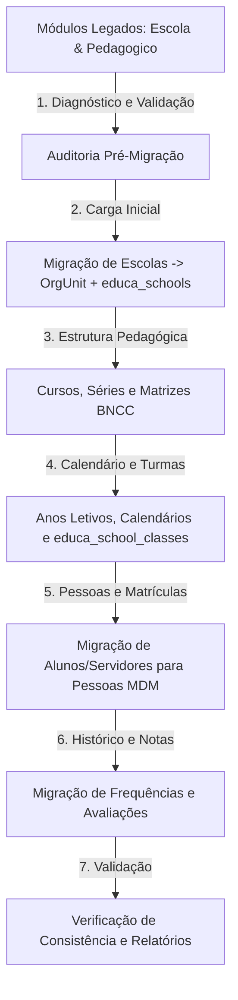

# SYS-Educa — Mapeamento de Migração dos Módulos Legados (`Escola` e `Pedagogico`)

Este documento estabelece o mapeamento técnico canônico, a estratégia de coexistência sem quebra (Strangler Fig Pattern) e os scripts de transição de dados das tabelas de `Modules/Escola` e `Modules/Pedagogico` para o novo ecossistema unificado **SYS-Educa** (`Modules/Educa`), conforme o Risco **R-01** do projeto.

---

## 🏛️ 1. Princípios da Migração

1. **Isolamento e Não Quebra Imediata**: Os módulos legados `Escola` e `Pedagogico` continuam operacionais durante a fase de transição. Nenhuma migration dropa ou altera tabelas antigas.
2. **Conformidade com os 5 Pilares do SYSGOV**:
   - **OrgChart**: Toda escola migrada vincula-se obrigatoriamente a uma `OrgUnit` (`org_units.id`). Se a escola legada não possuir `org_unit_id`, cria-se ou vincula-se a uma unidade correspondente no organograma municipal.
   - **Pessoas (MDM & LGPD)**: Alunos, servidores e responsáveis cadastrados na tabela legada `alunos` ou `membros_equipe` são deduplicados e unificados em `Modules\Pessoas\Models\Pessoa` via CPF (`documento_hash`) antes da criação dos vínculos escolares.
   - **Multi-Tenant Estrito**: Todos os scripts de migração operam com `tenant_id` preservado.
   - **Chaves Primárias**: As tabelas de destino `educa_*` utilizam PK UUID (`HasUuids`), preservando em coluna de metadados ou log de migração o ID legado de origem (`legacy_escola_id`, etc.) para reconciliação.
   - **LDB Compliance**: Diferente do legado, o SYS-Educa valida rigorosamente a meta de **200 dias letivos** e **800 horas anuais** (Lei 9.394/1996, art. 24, I).

---

## 🗺️ 2. De/Para de Estrutura de Tabelas e Entidades

| Entidade Legada (`Escola`/`Pedagogico`) | Tabela Legada | Entidade Alvo (`SYS-Educa`) | Tabela Alvo | Estratégia de Transformação e Reconciliação |
| :--- | :--- | :--- | :--- | :--- |
| **Escola** | `escolas` | `EducaSchool` | `educa_schools` | Vincula a `org_units.id`. Normaliza código INEP (8 dígitos), zona (urbana/rural) e situação de funcionamento. |
| **Trimestre / Etapa** | `trimestres` | `EducaAcademicStage` / `EducaStageType` | `educa_academic_stages` | Converte trimestres legados para etapas configuradas do tipo trimestral/bimestral com validação de datas. |
| **Materia** | `materias` | `EducaCurriculumComponent` | `educa_curriculum_components` | Normaliza a disciplina vinculando a uma `EducaKnowledgeArea` da BNCC e atribuindo código do Educacenso/INEP. |
| **Turma** | `turmas` | `EducaSchoolClass` | `educa_school_classes` | Mapeia para ano letivo e matriz curricular correspondente, normalizando turno (`matutino`, `vespertino`, etc.) e vagas. |
| **TurmaMateria** | `turma_materia` | `EducaMatrixComponent` | `educa_matrix_components` | Transforma o vínculo direto turma-disciplina em componentes da Matriz Curricular da série com cargas horárias semanais e anuais. |
| **Aluno** | `alunos` | `Pessoa` + `EducaEnrollment` | `pessoas` + `educa_enrollments` | Extrai os dados civis do aluno e responsáveis para `pessoas` (MDM) e gera a matrícula educacional no submódulo `secretaria`. |
| **MembroEquipe** | `membros_equipe` | `Pessoa` + `EducaStaff` | `pessoas` + `educa_staff` | Vincula a pessoa física com alocação e habilitação docente no submódulo `servidores`. |
| **Frequencia** | `frequencias` | `EducaAttendance` | `educa_attendances` | Migra registros de presença/falta referenciando o `EducaCalendarDay` correspondente no calendário da escola. |
| **Nota** | `notas` | `EducaGradeAssessment` | `educa_grade_assessments` | Normaliza notas e pareceres vinculados à etapa do ano letivo e ao componente da matriz. |
| **Ocorrencia** | `ocorrencias` | `EducaDisciplinaryOccurrence` | `educa_occurrences` | Trilha de ocorrências disciplinares mantida com vínculo polimórfico ou direto. |

---

## 🔄 3. Fases do Pipeline de Migração (Cutover)

### Fase 1: Diagnóstico e Sanitização
- Identificação de escolas sem código INEP ou duplicadas.
- Identificação de alunos e docentes sem CPF ou com registros duplicados no mesmo tenant.
- Verificação de turmas sem ano letivo definido.

### Fase 2: Carga do Core (Estrutura da Rede)
1. Criação/Associação das unidades escolares em `org_units`.
2. Criação das extensões educacionais em `educa_schools`.
3. Definição da árvore de cursos e séries municipais (`educa_courses`, `educa_grades`).
4. Criação dos calendários letivos com metas de 200 dias da LDB (`educa_academic_calendars`, `educa_calendar_days`).
5. Associação das disciplinas antigas com a base nacional comum curricular (`educa_curriculum_components`).

### Fase 3: Migração de Turmas e Carga Horária
- Geração das matrizes curriculares com soma mínima de 800 horas anuais.
- Migração das turmas antigas para `educa_school_classes` com aplicação das travas de capacidade física e turno.

### Fase 4: Migração de Alunos e Secretaria (Submódulo `secretaria`)
- Criação dos registros de pessoas físicas no módulo `Pessoas`.
- Geração dos registros de matrícula atômicos por ano letivo.

### Fase 5: Virada de Chave (Feature Toggle / Entitlements)
- O tenant passa a acessar as rotas de `educa` e `educa-secretaria`.
- Os menus dinâmicos em `client_menu_items` são atualizados para apontar para o novo módulo.
- O acesso de escrita aos módulos `Escola` e `Pedagogico` antigos é desabilitado (modo somente leitura).

---

## 🛡️ 4. Reconciliação e Rollback Seguro
- Todas as tabelas `educa_*` contêm trilha auditada pelo `AuditLogger`.
- Registros migrados recebem tag de auditoria `migrated_from_legacy: true` em metadados.
- Em caso de necessidade de contingência, os dados originais em `escolas` e `pedagogico` permanecem intactos.
