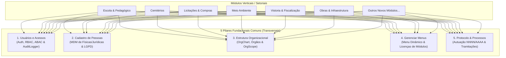

# 🏛️ Os 5 Pilares Fundacionais do SYSGOV (Módulos Core Transversais)

> **Contrato Arquitetural Canônico**: Este documento define a espinha dorsal de módulos comuns a todo o ecossistema SYSGOV. Todo módulo de negócio vertical (ex.: Escola, Cemitérios, Licitações, Contratos, Meio Ambiente, Vistoria, Obras, etc.) **DEVE** obrigatoriamente se integrar a esses 5 módulos transversais, respeitando o isolamento lógico multi-tenant rigoroso.

---

## 🧭 Visão Geral da Arquitetura

O SYSGOV é desenhado sobre o princípio de **Fronteiras Claras com Pilares Compartilhados**. Para evitar duplicação de dados, silos municipais e inconsistências cadastrais, cinco domínios de negócio são classificados como **Módulos Fundacionais Transversais (Core Foundation)**:



---

## 🔒 Regra de Ouro: Isolamento Multi-Tenant em Todas as Integrações

Em todas as integrações com os 5 pilares, a integridade do isolamento por tenant é **absoluta e inviolável**:
1. **Chaves Estrangeiras Tenant-Aware**: Todo relacionamento com qualquer um dos pilares deve ocorrer **estritamente dentro do mesmo tenant**.
2. **Índices Compostos**: Tabelas que fazem FK para Pessoas, OrgUnits ou Processos devem manter índices compostos iniciando por `tenant_id`:
   ```sql
   INDEX idx_modulo_tenant_pessoa (tenant_id, pessoa_id),
   INDEX idx_modulo_tenant_org_unit (tenant_id, org_unit_id)
   ```
3. **Modelos Eloquent**: Todo model utiliza a trait `App\Models\Concerns\TenantAware`.
4. **Resolução de Contexto**: O `tenant_id` é sempre injetado via `TenantContext` resolvido no backend pelo middleware `ResolveTenant`. Nunca aceitar ou confiar em `tenant_id` vindo de payload do cliente.

---

## 🧱 Detalhamento dos 5 Pilares Fundacionais

### 1. 🔑 Usuários e Acessos (`Modules/Access` / Auth / RBAC)
Responsável pelo ciclo de vida de identidade, autenticação, perfis de acesso, permissões granulares e trilha imutável de auditoria.

- **Contratos e Entidades**:
  - Model: `App\Models\User` (vinculado via tabela pivot `tenant_user`).
  - Permissões no padrão: `{modulo}.{recurso}.{acao}` (ex.: `escola.matriculas.criar`, `licitacao.editais.publicar`).
  - Gates e Policies server-side em todas as ações de escrita.
- **Rastreabilidade Obrigatória**:
  - Nenhuma mutação (create, update, delete) ocorre sem registro no `AuditLogger::log()`, persistido na tabela `audit_logs` com `tenant_id`, `user_id`, `modulo`, `acao`, `payload_before`, `payload_after`, `ip` e `user_agent`.
- **Regra para Módulos Setoriais**:
  - NUNCA crie tabela própria de usuários ou operadores.
  - Campos de autoria devem ser `user_id` ou `created_by` referenciando `users.id`.

---

### 2. 👥 Cadastro de Pessoas (`Modules/Pessoas` — MDM & LGPD)
Master Data Management (MDM) de qualquer pessoa física ou jurídica do município: munícipes, contribuintes, servidores, fornecedores, alunos, responsáveis legais e concessionários.

- **Contratos e Entidades**:
  - Model: `Modules\Pessoas\Models\Pessoa` (`tipo = 'FISICA'` ou `'JURIDICA'`).
  - Proteção LGPD: CPF e CNPJ armazenados mascarados em tela (`documento_mascarado`), com busca normalizada exclusivamente via hash determinístico `documento_hash` gerado por `Modules\Pessoas\Support\Documento::hash($digitos)`.
- **Regra para Módulos Setoriais**:
  - **PROIBIDO** criar tabelas duplicadas como `municipe`, `cidadao`, `fornecedor` ou `aluno` que repliquem dados civis (nome, CPF, RG, data de nascimento, filiação).
  - O módulo setorial deve criar uma chave estrangeira `pessoa_id` (ou `interessado_pessoa_id`) apontando para `pessoas.id`, acompanhada de tabela de extensão de perfil do módulo se necessário (ex.: `escola_alunos.pessoa_id`).
- **Frontend Canônico**:
  - No frontend React, todo formulário de busca ou seleção de pessoa **DEVE** utilizar o hook `usePessoaPicker` e/ou o componente `<PessoaPicker>` (`@/modules/pessoas/components/PessoaPicker` ou equivalente em `@sysgov/ui`).

---

### 3. 🏢 Estrutura Organizacional (`Modules/OrgChart` — Órgãos & OrgScope)
Representa a hierarquia administrativa do ente público: prefeitura, secretarias, diretorias, departamentos, divisões e setores.

- **Contratos e Entidades**:
  - Model: `Modules\OrgChart\Models\OrgUnit` (com hierarquia pai-filho `parent_id`, código do órgão e sigla).
  - Lotação: `Modules\OrgChart\Models\OrgUnitUser` associando servidores a unidades com atribuição de cargo/função.
  - Controle de Escopo (ABAC): `App\Support\OrgScope` ou `OrgScopeService` para filtrar registros conforme a secretaria ou unidade do usuário logado.
- **Regra para Módulos Setoriais**:
  - Todo registro que pertença a um departamento, secretaria ou setor municipal deve possuir coluna `org_unit_id` referenciando `org_units.id`.
  - **PROIBIDO** criar tabelas isoladas de "secretarias" ou "departamentos" em módulos individuais.
- **Frontend Canônico**:
  - Seleção de órgão/setor via componente de unidade administrativa com filtro de hierarquia por tenant.

---

### 4. 🧭 Gerenciar Menus (`Modules/Client` — Menus & Navegação Dinâmica)
Gerenciador centralizado da árvore de navegação do painel do cliente (`web-client`) e do painel administrativo (`web`).

- **Contratos e Entidades**:
  - Tabelas: `client_menu_groups`, `client_menu_items`, `client_module_licenses`.
  - Serviço: `Modules\Client\Services\ClientNavigationService`.
  - Resposta do endpoint de navegação: O menu é montado dinamicamente pelo backend baseado nos módulos licenciados para o tenant ativo e nas permissões efetivas do usuário autenticado.
- **Regra para Módulos Setoriais**:
  - Novos módulos não devem "chumbar" itens de menu hardcoded no App Shell do frontend.
  - O módulo deve registrar seu grupo de menu e itens via seeder ou migration tenant-aware em `client_menu_items`, informando:
    - `menu_group_id`: Grupo de navegação (ex.: Administrativo, Operacional, Gestão Escolar).
    - `label`: Título exibido.
    - `icon`: Nome do ícone Lucide/Phosphor padronizado.
    - `route`: Rota no frontend React (ex.: `/protocolo/processos`, `/cemiterios/concessoes`).
    - `permission_key`: Permissão necessária para visualização.
    - `order`: Ordem de exibição.

---

### 5. 📑 Protocolo e Processos Administrativos (`Modules/Protocolo`)
Módulo responsável pela autuação formal, numeração sequencial oficial no formato `NNNN/AAAA` (com lock atômico concorrente por tenant/ano), tramitação entre setores da OrgChart, despachos, prazos/SLA, histórico temporal de andamentos e controle de sigilo.

- **Contratos e Entidades**:
  - Model Principal: `Modules\Protocolo\Models\Processo`.
  - Vínculos Polimórficos: Tabela `protocolo_vinculos` (`processo_id`, `entidade_tipo`, `entidade_id`, `metadados`).
  - Contrato Obrigatório: `Modules\Protocolo\Contracts\EntidadeVinculavel`.
- **Regra para Módulos Setoriais**:
  - Sempre que uma entidade setorial (ex.: Requerimento, Solicitação de Licenciamento Ambiental, Processo Licitatório, Auto de Infração de Vistoria, Concessão de Jazigo) demandar formalização como processo administrativo do município, o módulo DEVE implementar `EntidadeVinculavel`:
    ```php
    namespace Modules\MeuModulo\Services;

    use Modules\Protocolo\Contracts\EntidadeVinculavel;

    class MeuModuloEntidadeAdapter implements EntidadeVinculavel
    {
        public function tipo(): string { return 'meu_modulo_item'; }
        public function existe(int $entidadeId): bool { ... }
        public function jaPromovida(int $entidadeId): bool { ... }
        public function aoPromover(int $entidadeId, int $processoId): void { ... }
        public function resumo(int $entidadeId): array { ... }
    }
    ```
  - Vinculação bidirecional: O processo exibe o item do módulo de origem na aba "Vínculos", e o módulo setorial exibe o processo correspondente no seu detalhe.

---

## 📋 Checklist de Integração Obrigatória para Novos Módulos

Ao implementar qualquer novo módulo no ecossistema SYSGOV, o desenvolvedor ou agente de IA DEVE preencher este checklist antes de concluir a tarefa:

| Pilar | Item do Checklist | Status Obrigatório |
|---|---|---|
| **Multi-Tenant** | Todas as tabelas possuem `tenant_id` com índice composto `(tenant_id, ...)` | ✅ Sim |
| **Multi-Tenant** | Todos os models Eloquent utilizam a trait `TenantAware` | ✅ Sim |
| **1. Usuários** | Operações usam `users.id`, permissões via `{modulo}.{recurso}.{acao}` e `AuditLogger::log()` | ✅ Sim |
| **2. Pessoas** | Referência a cidadãos/empresas usa `pessoa_id` (`Modules\Pessoas\Models\Pessoa`) sem duplicar cadastro | ✅ Sim |
| **3. OrgChart** | Setores/Secretarias usam `org_unit_id` (`Modules\OrgChart\Models\OrgUnit`) | ✅ Sim |
| **4. Menus** | Itens de navegação registrados no `ClientNavigationService` / `client_menu_items` | ✅ Sim |
| **5. Protocolo** | Processos e atos administrativos vinculáveis via `EntidadeVinculavel` / `protocolo_vinculos` | ✅ Sim |
