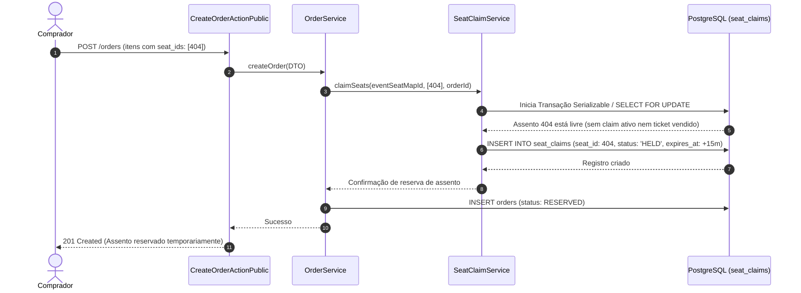

# Design Técnico: Assentos e Capacidade (`assentos-e-capacidade`)

**Projeto**: Hi.Events  
**Escala de Confiança**: 🟢 CONFIRMADO | 🟡 INFERIDO | 🔴 LACUNA  
**Status**: Aprovado  

---

## 1. Interface de Comunicação

### 1.1 Endpoints HTTP Públicos e de Gestão

| Método | Caminho | Entrada | Saída | Status Codes | Confiança |
|---|---|---|---|:---:|:---:|
| `GET` | `/api/public/events/{event_id}/occurrences/{occurrence_id}/seat-map` | - | `PublicSeatMapResource` | 200, 404 | 🟢 CONFIRMADO |
| `POST` | `/api/manage/events/{event_id}/seat-maps` | `CreateEventSeatMapRequest` | `EventSeatMapResource` | 201, 403, 422 | 🟢 CONFIRMADO |
| `PUT` | `/api/manage/events/{event_id}/seat-maps/{map_id}/bands` | `UpdateEventSeatMapBandProductsRequest` | `EventSeatMapResource` | 200, 403, 422 | 🟢 CONFIRMADO |
| `POST` | `/api/manage/events/{event_id}/seat-maps/{map_id}/block-seats` | `BlockSeatsRequest` | `jsonResponse` | 200, 403 | 🟢 CONFIRMADO |

### 1.2 Principais Classes e Assinaturas 🟢

| Símbolo | Assinatura | Retorno | Observação |
|---|---|---|---|
| `SeatClaimService.claimSeats` | `(int $eventSeatMapId, array $seatIds, int $orderId, int $ttlMinutes): array` | `array<SeatClaim>` | Executa bloqueio atômico com verificação de colisão. |
| `SeatClaimService.releaseClaim` | `(int $orderId): void` | `void` | Deleta as tuplas ativas de reivindicação em `seat_claims`. |
| `SeatClaimService.getDerivedSeatStatus` | `(int $seatId, int $eventSeatMapId): string` | `string` | Retorna `HELD`, `SOLD`, `BLOCKED` ou `AVAILABLE` em tempo real. |
| `UpdateEventSeatMapBandProductsRequest` | `withValidator(Validator $validator)` | `void` | Valida ausência de duplicidade pós-autorização sem regra `distinct`. |

---

## 2. Fluxo Principal de Processamento



---

## 3. Fluxos Alternativos e Exceções 🟢

- **Colisão de Assento (Tentativa Concorrente)**: Se outro comprador já registrou `SeatClaim` válido ou se o assento já consta como emitido em ingresso pago, `claimSeats` lança `SeatClaimConflictException`. A `BaseAction` intercepta e devolve `HTTP 409 Conflict`.
- **Expiração do Timer de Checkout**: Ao transicionar a ordem para `ABANDONED`, o `OrderService` invoca `SeatClaimService::releaseClaim($orderId)`, removendo fisicamente os registros de bloqueio temporário do banco de dados.
- **Validação de Assentos Duplicados no Payload**: O request `UpdateEventSeatMapBandProductsRequest` rejeita IDs duplicados dentro de `withValidator()`, evitando o overhead quadrático $O(n^2)$ de validações pré-autorização.

---

## 4. Dependências de Componentes

| Componente | Tipo de Dependência | Propósito |
|---|---|---|
| `OrderService` | Interna (Domain Service) | Orquestra a confirmação final ou cancelamento de assentos retidos. |
| `EventOccurrence` | Modelo de Domínio | Determina a capacidade nominal física da ocorrência. |
| `Enterprise License Guard` | Autorização EE | Garante que rotas de assentos reservados exijam licença comercial válida (`backend/ee/`). |

---

## 5. Decisões de Design Arquiteturais (ADR-Linked) 🟢

| Decisão | Evidência no Código | Confiança |
|---|---|:---:|
| **Status Derivados em Tempo Real** | Sem reconciliadores de banco gravando `SOLD_OUT` ou `HELD`/`SOLD`/`BLOCKED` | 🟢 CONFIRMADO |
| **Proibição da Regra Distinct do Laravel** | Validação customizada pós-autorização em `UpdateEventSeatMapBandProductsRequest` | 🟢 CONFIRMADO |
| **Código EE Isolado sob `backend/ee/`** | Separado da licença AGPL, coberto pela licença comercial do Hi.Events | 🟢 CONFIRMADO |

---

## 6. Estado Interno e Máquina de Transição de Assentos

```
Assento Livre (sem registro)
       │
       ▼ [claimSeats() durante checkout]
   HELD (bloqueio temporário com expires_at)
  ├──► [Pagamento aprovado] ──► SOLD (permanente vinculado ao Attendee)
  └──► [Timer expirou / Cancelou] ──► Assento Livre (registro removido)

[Ação de Organizador] ──► BLOCKED (bloqueio administrativo de assento)
```

---

## 7. Observabilidade e Auditoria 🟢

- Tentativas frustradas de colisão de assento registram logs de nível `WARNING` para identificação de gargalos de concorrência.
- O histórico de alterações em mapas de assentos e faixas de preço (`event_seat_map_bands`) é registrado na auditoria administrativa da conta.
