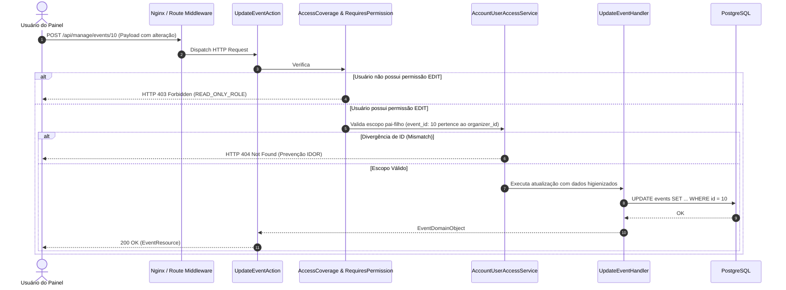

# Design Técnico: Autenticação e Permissões (`autenticacao-e-permissoes`)

**Projeto**: Hi.Events  
**Escala de Confiança**: 🟢 CONFIRMADO | 🟡 INFERIDO | 🔴 LACUNA  
**Status**: Aprovado  

---

## 1. Interface de Comunicação

### 1.1 Endpoints HTTP de Autenticação e Acesso

| Método | Caminho | Entrada | Saída | Status Codes | Confiança |
|---|---|---|---|:---:|:---:|
| `POST` | `/api/auth/login` | `LoginRequest` (email, password) | `AuthResource` | 200, 401, 422 | 🟢 CONFIRMADO |
| `POST` | `/api/auth/two-factor/challenge` | `TwoFactorChallengeRequest` (code) | `AuthResource` | 200, 401 | 🟢 CONFIRMADO |
| `POST` | `/api/auth/logout` | - | `jsonResponse` | 200, 401 | 🟢 CONFIRMADO |
| `GET` | `/api/manage/accounts/{account_id}/users` | Query filters | `AccountUserCollectionResource` | 200, 403 | 🟢 CONFIRMADO |
| `POST` | `/api/manage/accounts/{account_id}/users/{user_id}/permissions` | `UpdatePermissionsRequest` | `AccountUserResource` | 200, 403, 422 | 🟢 CONFIRMADO |

### 1.2 Principais Classes e Assinaturas 🟢

| Símbolo | Assinatura | Retorno | Observação |
|---|---|---|---|
| `BaseAction.isActionAuthorized` | `(): bool` | `bool` | Inspeciona contexto do usuário autenticado contra permissões exigidas. |
| `#[RequiresPermission]` | `attribute(Permission $permission)` | `Attribute` | Atributo PHP 8 em Actions para guarda estática de permissão. |
| `AccountUserAccessService.withoutMemberRestrictions` | `(Closure $callback): mixed` | `mixed` | Executa rotinas de infraestrutura/background contornando filtros do tenant. |
| `PersonNameRule.passes` | `(string $attribute, mixed $value): bool` | `bool` | Valida ausência de caracteres de injeção, URLs e termos maliciosos. |
| `useAccess` *(Frontend)* | `(permission: Permission): boolean` | `boolean` | Hook React que consulta as permissões do usuário carregadas no contexto SSR. |

---

## 2. Fluxo Principal de Processamento



---

## 3. Fluxos Alternativos e Exceções 🟢

- **Tentativa de Escrita por Usuário de Somente-Leitura (`VIEWER`)**:
  - Middleware intercepta qualquer requisição HTTP diferente de `GET`. Se o usuário não possui `EDIT` e a action não possui `#[AllowedForReadOnlyUsers]`, retorna `HTTP 403 (READ_ONLY_ROLE)`.
- **Mismatch de Identificadores (Prevenção IDOR)**:
  - Todo lookup de IDs filhos em rotas ou payloads (ex: `price_id`, `product_id`, `template_id`) é obrigatoriamente validado contra o `event_id` ou `organizer_id` autorizado. Caso não coincidam, o sistema aborta imediatamente com `HTTP 404` ou `HTTP 422` antes de qualquer execução de domínio.
- **Detecção de Spam e Injeção de Código**:
  - Conteúdos de eventos submetidos para publicação disparam `EventSpamCheckDispatchService`. Textos contendo padrões suspeitos transicionam o evento para `PENDING_MANUAL_REVIEW`, impedindo a publicação pública até liberação manual pelo superadministrador.

---

## 4. Dependências de Componentes

| Componente | Tipo de Dependência | Propósito |
|---|---|---|
| `Laravel Sanctum` | Autenticação | Gerenciamento de tokens de API e cookies de sessão stateful. |
| `HtmlPurifierService` | Segurança | Sanitização e higienização de tags HTML antes da persistência. |
| `EmailContextHtmlEscaper` | Template Rendering | Escape contextual de tokens Liquid em corpos de e-mail. |
| `AsyncLocalStorage` | Frontend SSR | Isolamento de contexto de requisição do usuário no servidor Node.js. |

---

## 5. Decisões de Design Arquiteturais (ADR-Linked) 🟢

| Decisão | Evidência no Código | Confiança |
|---|---|:---:|
| **Inspeção por Permissão e Não por Papel** | Uso de `Permission::VIEW_FINANCIALS` e `useAccess()`, proibindo `me.role` | 🟢 CONFIRMADO |
| **Sanitização Dupla de E-mails** | Purificação antes do armazenamento e novamente após a renderização do Liquid | 🟢 CONFIRMADO |
| **Exibição Segura de E-mails em Iframe** | Renderização com atributo `sandbox=""` em vez de `dangerouslySetInnerHTML` | 🟢 CONFIRMADO |

---

## 6. Estado Interno e Máquina de Transição do Usuário

```
[*] --> ACTIVE (convite aceito e credenciais validadas)
ACTIVE --> SUSPENDED (bloqueio manual por superadmin por violação)
ACTIVE --> INACTIVE (desativação temporária pelo administrador da conta)
INACTIVE --> ACTIVE (reativação pelo administrador)
SUSPENDED --> [*]
```

---

## 7. Observabilidade e Auditoria 🟢

- Ações que alteram permissões de membros geram registros em `account_user_access_grants`.
- Tentativas de acesso não autorizado com `READ_ONLY_ROLE` são contabilizadas para detecção de anomalias operacionais.
