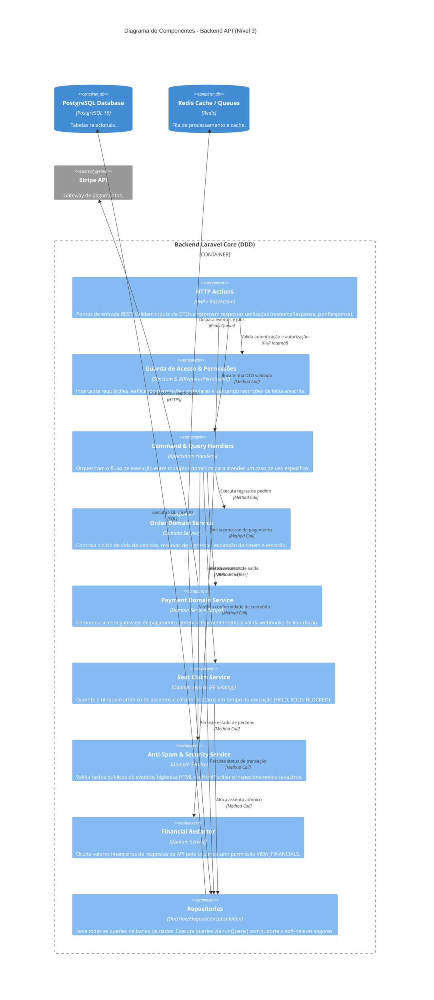

# C4 Model — Diagrama de Componentes (Nível 3)

**Projeto**: Hi.Events  
**Escala de Confiança**: 🟢 CONFIRMADO | 🟡 INFERIDO | 🔴 LACUNA  
**Fonte Técnica**: `backend/app/Http/Actions/`, `backend/app/Services/Domain/`, `backend/app/Repositories/`

---

## 1. Visão Geral dos Componentes do Backend (Core API)

O container `backend` do Hi.Events segue rigorosamente uma arquitetura orientada a domínio (Domain-Driven Design), com separação estrita de responsabilidades em camadas e fluxo unidirecional:
**Action (Transporte/HTTP) → Handler (Coordenação de Caso de Uso) → Domain Service (Lógica de Domínio) → Repository (Persistência / Eloquent)**.

---

## 2. Descrição Detalhada dos Componentes Chave 🟢

### 2.1 Camada de Ações HTTP (`Http Actions`)
- **Herança**: Todas as ações estendem `BaseAction`.
- **Regra de Retorno**: Nunca retornam diretamente `response()->json()` ou instâncias diretas de `JsonResponse`. Em vez disso, utilizam métodos helper padronizados:
  - `resourceResponse()`: Formatação estruturada de entidades via Resources do Laravel.
  - `jsonResponse()`: Dados avulsos ou operações de sucesso simples.
  - `errorResponse()`: Respostas formatadas de erro padronizadas.
  - `deletedResponse()`: Confirmação de exclusão idempotente.
- **Divisão de Rotas**: Um endpoint por ação física (Single Action Controllers). Ações públicas utilizam o sufixo `*Public` e recursos que omitem campos confidenciais internos (como `location_id` ou identificadores sensíveis).

### 2.2 Camada de Segurança e Autorização (`Access & Permissions`)
- **Inspeção de Permissão**: Utilização de atributos PHP 8 `#[RequiresPermission(Permission::...)]` ou chamadas a `isActionAuthorized()` e `isOrganizerReadAuthorized()`.
- **Proteção contra Escrita Não-Autorizada**: Usuários com perfil `VIEWER` (somente leitura) recebem imediatamente `HTTP 403 (READ_ONLY_ROLE)` em requisições de mutação (POST, PUT, PATCH, DELETE), a menos que a rota seja explicitamente liberada por `#[AllowedForReadOnlyUsers]`.
- **Escopo Rígido de Entidades Filhas**: Todo lookup de chave estrangeira em rota ou payload (ex: `order_id`, `product_id`, `template_id`) é estritamente validado sob o escopo do identificador pai autorizado (`event_id` ou `organizer_id`), respondendo 404/422 em caso de divergência antes de qualquer efeito colateral.

### 2.3 Camada de Serviços de Domínio (`Domain Services`)
- **Regras Imutáveis**:
  - `OrderService`: Coordena criação e conclusão de pedidos. Garante que contadores de afiliados, uso de códigos promocionais e métricas agregadas de volume de produto (`products.sales_volume`) só sejam computados quando `isOrderCompleted()` for verdadeiro.
  - `StripePaymentService`: Gerencia Payment Intents e webhooks de confirmação. Registra taxas de plataforma e taxas de aplicação (`OrderApplicationFee`).
  - `SeatClaimService`: Gerencia reservas atômicas de assentos. Status de assentos (`HELD`, `SOLD`, `BLOCKED`) e de ocorrência (`SOLD_OUT`) são exclusivamente calculados em tempo de execução, sem persistência fixa em tabelas de sincronização.
  - `EventSpamCheckDispatchService`: Higieniza textos com `HtmlPurifierService` e bloqueia termos suspeitos via `PersonNameRule`.

### 2.4 Camada de Repositórios (`Repositories`)
- **Isolamento do ORM**: Eloquent é estritamente confinado dentro de Repositórios. Handlers e Services interagem com dados através de contratos de repositório e DTOs tipados.
- **Operações Críticas**:
  - Métodos customizados de consulta são encapsulados em `runQuery()`.
  - Atualizações em entidades com deleção lógica utilizam `incrementEach()` e `decrementEach()` para evitar falhas silenciosas ou exceções de runtime em linhas com soft-delete.
