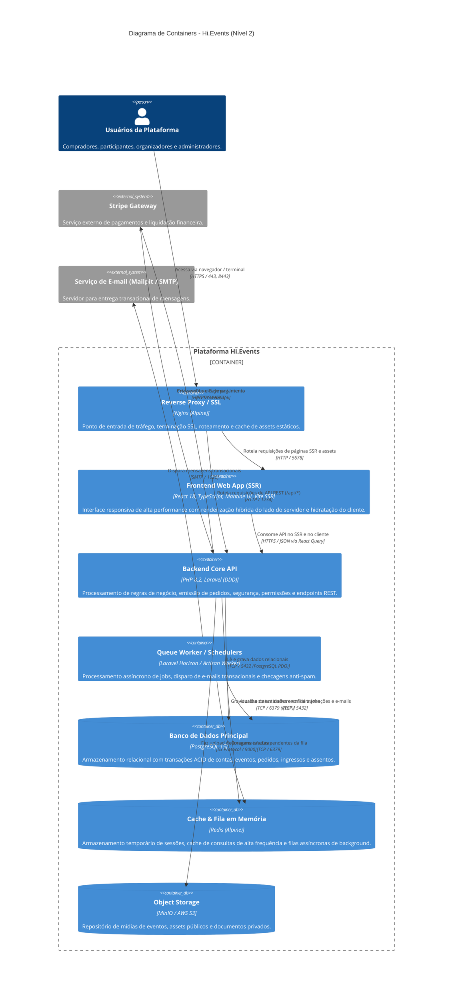

# C4 Model — Diagrama de Containers (Nível 2)

**Projeto**: Hi.Events  
**Escala de Confiança**: 🟢 CONFIRMADO | 🟡 INFERIDO | 🔴 LACUNA  
**Fonte Técnica**: `docker/development/docker-compose.dev.yml`, `backend/routes/api.php`, `frontend/src/entry.server.tsx`

---

## 1. Visão Geral dos Containers

O sistema Hi.Events é desacoplado em serviços conteinerizados independentes, operando com arquitetura híbrida de renderização do lado do servidor (SSR) no frontend e uma API REST robusta estruturada com Domain-Driven Design no backend.

---

## 2. Detalhamento Tecnológico dos Containers 🟢

### 2.1 `frontend` (SSR Web Application)
- **Tecnologia**: React 18, TypeScript, Vite, Mantine UI, Lingui i18n.
- **Modos de Operação**:
  - `dev:ssr` (Porta 5678): Renderização do lado do servidor para SEO e otimização de tempo de carregamento de páginas públicas de eventos.
  - `dev:csr` (Porta 5678): Modo alternativo Client-Side Rendered com suporte a hot reload para desenvolvimento rápido.
- **Gestão de Estado**: React Query (`@tanstack/react-query`) para requisições de dados e cache assíncrono. Isolamento de contexto no SSR garantido por `AsyncLocalStorage` (`utilites/ssrRequestContext.ts`).

### 2.2 `backend` (Core API)
- **Tecnologia**: PHP 8.2+, Laravel 10/11 com Domain-Driven Design (DDD).
- **Estruturação**:
  - Camada de Transporte: `BaseAction` e helpers de resposta padronizados.
  - Camada de Aplicação: DTOs (`BaseDataObject`), Handlers e Domain Services.
  - Camada de Acesso a Dados: Repositórios encapsulando Eloquent (`runQuery()`).
- **Segurança**: Políticas RBAC via atributos `#[RequiresPermission]`, autenticação por tokens Sanctum e cookies HttpOnly seguros.

### 2.3 `queue_worker` (Background Processing)
- **Tecnologia**: Laravel Queue / Horizon sobre Redis.
- **Responsabilidades**:
  - Envio de e-mails transacionais via classes filhas de `BaseMail` (com garantia de `afterCommit()`).
  - Inspeção e despacho de verificações anti-spam (`EventSpamCheckDispatchService`).
  - Webhooks de sincronização de dados e expiração de reservas abandonadas.

### 2.4 `pgsql` (Relational Database)
- **Tecnologia**: PostgreSQL 15.
- **Isolamento**: Banco operacional principal (`hievents`) e banco dedicado e isolado de testes de integração (`hievents_test`).
- **Padrão de Migração**: Migrations anônimas com integridade referencial via chaves estrangeiras e deleção lógica (`softDeletes`).

### 2.5 `redis` (Cache & Queue Broker)
- **Tecnologia**: Redis Alpine.
- **Responsabilidades**: Broker de mensagens de alta performance para o driver de filas do Laravel e cache temporário de configurações globais e flags de licença corporativa.

### 2.6 `minio` / Object Storage
- **Tecnologia**: MinIO S3-compatible storage.
- **Buckets Criados**:
  - `hievents-public`: Acesso anônimo de leitura para fotos de capa, logotipos e avatares.
  - `hievents-private`: Acesso estritamente autenticado para relatórios, comprovantes fiscais e backups.
