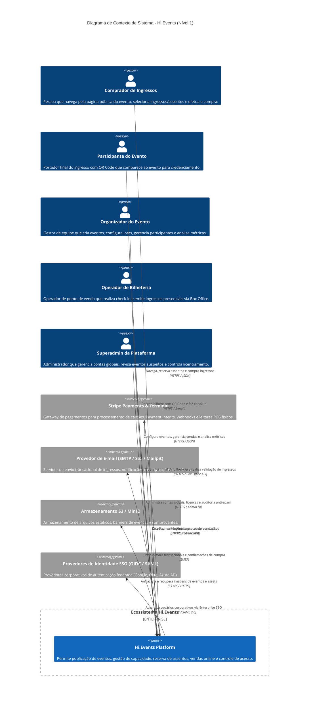

# C4 Model — Diagrama de Contexto (Nível 1)

**Projeto**: Hi.Events  
**Escala de Confiança**: 🟢 CONFIRMADO | 🟡 INFERIDO | 🔴 LACUNA  
**Fonte Técnica**: `docker/development/docker-compose.dev.yml`, `backend/routes/api.php`, `frontend/src/router.tsx`

---

## 1. Visão Geral do Contexto do Sistema

O **Hi.Events** é uma plataforma open-source de gestão de eventos e venda de ingressos com suporte a multi-inquilinos (contas/organizadores), mapa de assentos reservados, bilheteria presencial (box office), emissão de ingressos com QR Code e pagamentos integrados via Stripe.

---

## 2. Personas e Papéis Identificados 🟢

1. **Comprador (`Ticket Buyer`)**: Acessa rotas públicas (`/public/events/{id}`), consulta lotes disponíveis, seleciona assentos no mapa interativo e preenche dados cadastrais.
2. **Participante (`Attendee`)**: Recebe ingresso individualizado por e-mail, exibe QR Code para leitura no portão de entrada e responde a questionários personalizados do evento.
3. **Organizador (`Event Organizer`)**: Acessa o dashboard operacional (`/manage/events/{id}`), cria ocorrências (`event_occurrences`), gerencia descontos e acessa relatórios financeiros caso possua `VIEW_FINANCIALS`.
4. **Operador de Bilheteria (`Box Office Operator`)**: Utiliza rotas dedicadas de bilheteria e leitores de ponto de venda físicos (Stripe Terminal Reader). Não possui acesso a PII de participantes conforme restrições de segurança.
5. **Superadministrador (`Superadmin`)**: Acesso global para fiscalização de eventos marcados pelo filtro anti-spam (`PENDING_MANUAL_REVIEW`), gestão de limites e auditoria.

---

## 3. Limites de Integração Externa 🟢

| Sistema Externo | Tipo de Comunicação | Protocolo | Responsabilidade | Confiança |
|---|---|---|---|:---:|
| **Stripe** | Bidirecional | HTTPS (API Rest + Webhook) | Processamento de cartões de crédito, Payment Intents, reembolsos e controle de leitores de terminal POS. | 🟢 CONFIRMADO |
| **Provedor de E-mail (SMTP / SES / Mailpit)** | Unidirecional (Saída) | SMTP / TLS | Envio transacional assíncrono via filas de e-mails com ingressos anexados, confirmações e 2FA. | 🟢 CONFIRMADO |
| **Object Storage (S3 / MinIO)** | Bidirecional | S3 Protocol (HTTPS) | Armazenamento de imagens públicas (banners, logos de organizadores) e documentos privados (faturas/exportações). | 🟢 CONFIRMADO |
| **Identity Providers (OIDC / SAML)** | Bidirecional | HTTPS / OIDC standard | Autenticação corporativa com Single Sign-On (recurso Enterprise). | 🟢 CONFIRMADO |
