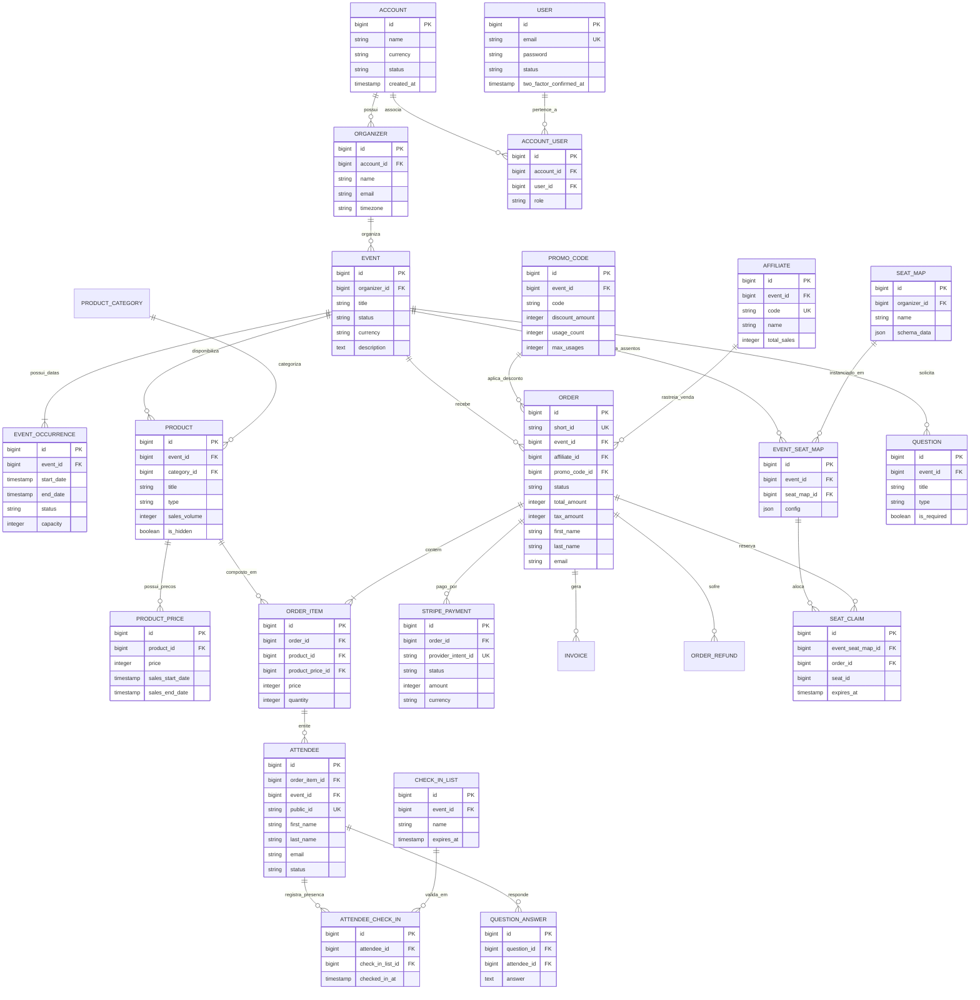

# Diagrama Entidade-Relacionamento Completo (ERD)

**Projeto**: Hi.Events  
**Escala de Confiança**: 🟢 CONFIRMADO | 🟡 INFERIDO | 🔴 LACUNA  
**Fonte Técnica**: `backend/app/Models/`, `database/migrations/`, `_reversa_sdd/data-dictionary.md`

---

## 1. Visão Geral do Modelo de Dados

O modelo relacional do **Hi.Events** é projetado com isolamento multi-inquilino através de `Account` e `Organizer`. Ele suporta eventos recorrentes ou multi-data através de `EventOccurrence`, ingressos e precificação por camadas em `Product` e `ProductPrice`, reservas de pedidos em `Order` e `OrderItem`, participantes individualizados em `Attendee` e controle de assentos reservados em `SeatMap` e `SeatClaim`.

---

## 2. Destaques de Integridade e Modelagem Relacional 🟢

1. **Gestão de Datas Multi-Ocorrência (`event_occurrences`)**:
   - As datas reais de realização do evento são exclusivamente armazenadas em `event_occurrences`.
   - As colunas legadas `events.start_date` e `events.end_date` são mantidas estritamente para compatibilidade de rollback v1 e nunca devem ser lidas ou modificadas.
2. **Status Dinâmicos e Derivados (Non-stored Enums)**:
   - A tabela `event_occurrences` armazena apenas `ACTIVE` ou `CANCELLED`. O status de exibição `SOLD_OUT` é calculado dinamicamente em runtime através da comparação entre a capacidade atribuída (`capacity`) e a soma de ingressos emitidos/reservados.
   - Os estados de assentos `HELD`, `SOLD` e `BLOCKED` são avaliados atômica e temporariamente com base no timer de checkout e conclusão da ordem em `SeatClaim`.
3. **Segurança de Acesso e Isolamento Multi-Inquilino**:
   - Todas as entidades filhas de um evento (`products`, `orders`, `seat_maps`, `questions`) possuem chave estrangeira explícita referenciando o `event_id`, garantindo que queries de repositório nunca consultem dados órfãos ou cruzem organizadores distintos.
