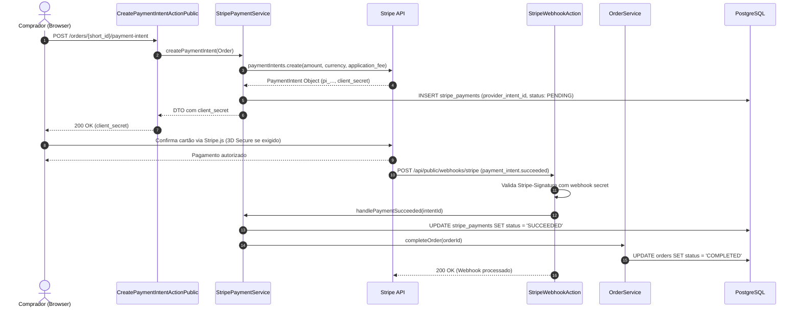

# Design Técnico: Pagamentos e Stripe (`pagamentos`)

**Projeto**: Hi.Events  
**Escala de Confiança**: 🟢 CONFIRMADO | 🟡 INFERIDO | 🔴 LACUNA  
**Status**: Aprovado  

---

## 1. Interface de Comunicação

### 1.1 Endpoints HTTP Públicos e Administrativos

| Método | Caminho | Entrada | Saída | Status Codes | Confiança |
|---|---|---|---|:---:|:---:|
| `POST` | `/api/public/events/{event_id}/orders/{short_id}/payment-intent` | `CreatePaymentIntentRequest` | `PaymentIntentResource` | 200, 400, 404 | 🟢 CONFIRMADO |
| `POST` | `/api/public/webhooks/stripe` | Raw Payload + `Stripe-Signature` | `jsonResponse` | 200, 400 | 🟢 CONFIRMADO |
| `POST` | `/api/manage/events/{event_id}/orders/{order_id}/refund` | `RefundOrderRequest` | `OrderRefundResource` | 200, 403, 422 | 🟢 CONFIRMADO |
| `GET` | `/api/manage/events/{event_id}/financials` | Query filters | `FinancialSummaryResource` | 200, 403 | 🟢 CONFIRMADO |

### 1.2 Principais Classes e Assinaturas 🟢

| Símbolo | Assinatura | Retorno | Observação |
|---|---|---|---|
| `CreatePaymentIntentActionPublic` | `__invoke(Request $request, int $eventId, string $shortId)` | `JsonResponse` | Gera Payment Intent no Stripe e retorna `client_secret`. |
| `StripeWebhookAction` | `__invoke(Request $request)` | `Response` | Valida assinatura Stripe e despacha job de tratamento assíncrono. |
| `StripePaymentService.createPaymentIntent` | `(OrderDomainObject $order): StripePaymentIntentDomainObject` | `StripePaymentIntentDomainObject` | Calcula taxas da plataforma e cria intent no Stripe Connect. |
| `FinancialStatsRedactor.redact` | `(array $stats, User $user): array` | `array` | Remove métricas financeiras se o usuário não tiver `VIEW_FINANCIALS`. |
| `OrderPaymentStatus` | `Enum: PENDING, SUCCEEDED, FAILED, CANCELLED` | `string` | Status canônico persistido na tabela `stripe_payments`. |

---

## 2. Fluxo Principal de Processamento



---

## 3. Fluxos Alternativos e Exceções 🟢

- **Falha no Cartão ou Saldo Insuficiente**: O Stripe emite o webhook `payment_intent.payment_failed`. O serviço marca o registro `StripePayment` como `FAILED`. O pedido permanece em `RESERVED` até a expiração do timer ou nova tentativa do comprador.
- **Assinatura Inválida no Webhook**: Qualquer payload recebido cujo cálculo HMAC SHA-256 não case com o header `Stripe-Signature` gera `HTTP 400 Bad Request` imediato e um log crítico de segurança.
- **Estorno Total / Parcial (`OrderRefundAction`)**:
  - Requer que o usuário autenticado possua cumulativamente as permissões `EDIT`, `VIEW_FINANCIALS` e `ISSUE_REFUNDS`.
  - Executa chamada à API de Refund do Stripe (`refunds.create`). Ao confirmar, decrementa `products.sales_volume` via `decrementEach()` e cancela os `Attendees` selecionados.

---

## 4. Dependências de Componentes

| Componente | Tipo de Dependência | Propósito |
|---|---|---|
| `Stripe PHP SDK` | Externa | Comunicação oficial com APIs REST do Stripe. |
| `OrderService` | Interna (Domain Service) | Notificação de liquidação financeira e conclusão de vendas. |
| `FinancialStatsRedactor` | Interna (Access Control) | Filtro de segurança de dados para usuários sem `VIEW_FINANCIALS`. |
| `WebhookLog` | Auditoria | Persistência de payloads de webhooks recebidos para auditoria e debug. |

---

## 5. Decisões de Design Arquiteturais (ADR-Linked) 🟢

| Decisão | Evidência no Código | Confiança |
|---|---|:---:|
| **Segregação de Permissão Financeira** | `backend/app/Http/Resources/EventResource.php` (`mergeWhen($this->isPermitted(...))`) | 🟢 CONFIRMADO |
| **Garantia de Idempotência por Intent ID** | Coluna `provider_intent_id` com índice único na tabela `stripe_payments` | 🟢 CONFIRMADO |
| **Isolamento de Processamento Assíncrono** | Webhooks enfileiram jobs de segundo plano evitando timeout do gateway | 🟢 CONFIRMADO |

---

## 6. Estado Interno e Máquina de Transição

Os estados permitidos da entidade `StripePayment` (`OrderPaymentStatus`) são:

```
[*] --> PENDING (criação da intent no Stripe)
PENDING --> SUCCEEDED (webhook payment_intent.succeeded)
PENDING --> FAILED (webhook payment_intent.payment_failed)
PENDING --> CANCELLED (cancelamento do checkout antes da captura)
FAILED --> PENDING (nova tentativa de pagamento)
SUCCEEDED --> [*]
CANCELLED --> [*]
```

---

## 7. Observabilidade e Auditoria 🟢

- **Auditoria de Webhook**: Todo webhook recebido é registrado em `webhook_logs` com status HTTP retornado, tempo de execução e payload bruto.
- **Rastreamento de Taxas**: A tabela `order_payment_platform_fees` audita a retenção exata de receita da plataforma em cada liquidação.
