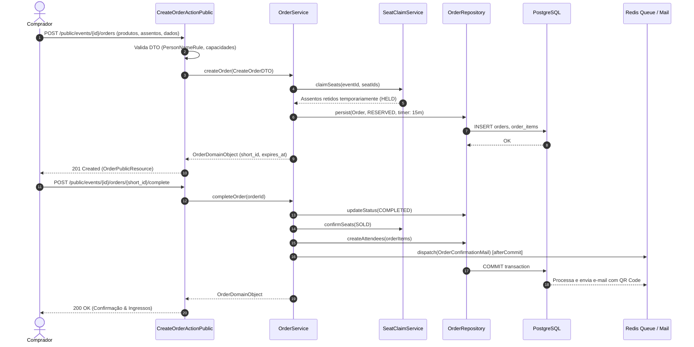

# Design Técnico: Pedidos e Ingressos (`pedidos`)

**Projeto**: Hi.Events  
**Escala de Confiança**: 🟢 CONFIRMADO | 🟡 INFERIDO | 🔴 LACUNA  
**Status**: Aprovado  

---

## 1. Interface de Comunicação

### 1.1 Endpoints HTTP Públicos e de Gestão

| Método | Caminho | Entrada (DTO / Request) | Saída (Resource) | Status Codes | Confiança |
|---|---|---|---|:---:|:---:|
| `POST` | `/api/public/events/{event_id}/orders` | `CreateOrderRequest` | `OrderPublicResource` | 201, 422, 404, 409 | 🟢 CONFIRMADO |
| `GET` | `/api/public/events/{event_id}/orders/{short_id}` | Parâmetros de rota | `OrderPublicResource` | 200, 404 | 🟢 CONFIRMADO |
| `POST` | `/api/public/events/{event_id}/orders/{short_id}/complete` | `CompleteOrderRequest` | `OrderPublicResource` | 200, 400, 422 | 🟢 CONFIRMADO |
| `GET` | `/api/manage/events/{event_id}/orders` | Query filters (status, page) | `OrderCollectionResource` | 200, 403 | 🟢 CONFIRMADO |
| `POST` | `/api/manage/events/{event_id}/orders/{order_id}/cancel` | `CancelOrderRequest` | `OrderResource` | 200, 403, 422 | 🟢 CONFIRMADO |
| `POST` | `/api/manage/events/{event_id}/orders/{order_id}/resend-confirmation` | - | `jsonResponse` | 200, 403, 404 | 🟢 CONFIRMADO |

### 1.2 Principais Classes e Assinaturas de Métodos 🟢

| Símbolo | Assinatura | Retorno | Observação |
|---|---|---|---|
| `CreateOrderActionPublic` | `__invoke(CreateOrderRequest $request, int $eventId)` | `JsonResponse` | Herda de `BaseAction`, formata via `resourceResponse()`. |
| `OrderService.createOrder` | `(CreateOrderDTO $dto): OrderDomainObject` | `OrderDomainObject` | Executa validação de capacidade atômica e cria a reserva temporária. |
| `OrderService.completeOrder` | `(int $orderId, CompleteOrderDTO $dto): OrderDomainObject` | `OrderDomainObject` | Transiciona para `COMPLETED`, emite participantes e aciona `BaseMail::afterCommit()`. |
| `OrderService.expireOrder` | `(int $orderId): void` | `void` | Transiciona para `ABANDONED` e dispara liberação de assentos e lotes. |
| `OrderRepository.findFirstWhere` | `(array $criteria): ?Order` | `?Order` | Encapsula busca Eloquent via `runQuery()`. |

---

## 2. Fluxo Principal de Processamento



---

## 3. Fluxos Alternativos e Exceções 🟢

- **Esgotamento de Lote (Concorrência)**: Se a capacidade restante do produto for menor que a quantidade requisitada no instante da transação, o `OrderService` lança `ResourceConflictException`, convertida pela `BaseAction` em `HTTP 409 Conflict`.
- **Expiração de Tempo de Reserva**: Caso o comprador não liquide a ordem antes de `expires_at`, o job agendado aciona `OrderService::expireOrder`, atualizando o status para `ABANDONED` e invocando `SeatClaimService::releaseClaim`.
- **Cancelamento Manual por Organizador**: Exige permissão `EDIT`. Se o pedido já gerou participantes ativos (`Attendee`), os mesmos são marcados como `CANCELLED` e os contadores de afiliados/produtos são decrementados com `decrementEach()`.

---

## 4. Dependências de Componentes

| Componente | Tipo de Dependência | Propósito |
|---|---|---|
| `SeatClaimService` | Interna (Domain Service) | Bloqueio atômico e liberação de assentos reservados no mapa. |
| `StripePaymentService` | Interna (Domain Service) | Criação de Payment Intent vinculada ao total e moeda da ordem. |
| `PersonNameRule` | Validação | Sanitização de nomes de compradores para prevenção contra spam. |
| `BaseMail / OrderConfirmationMail` | Assíncrona (Queue) | Entrega de e-mails transacionais pós-confirmação com ingressos. |

---

## 5. Decisões de Design Arquiteturais (ADR-Linked) 🟢

| Decisão | Evidência no Código | Confiança |
|---|---|:---:|
| **Encapsulamento Estrito de Eloquent** | `backend/app/Repositories/OrderRepository.php` | 🟢 CONFIRMADO |
| **Status Derivados em Runtime** | Status `SOLD_OUT` e travas de lotes calculados sem tabela de reconciliação | 🟢 CONFIRMADO |
| **Identificador Público Seguro (`short_id`)** | IDs numéricos sequenciais são omitidos nas URLs públicas para prevenir enumeração | 🟢 CONFIRMADO |
| **Garantia de E-mail após Commit** | E-mails transacionais utilizam `afterCommit()` da `BaseMail` | 🟢 CONFIRMADO |

---

## 6. Estado Interno e Máquina de Transição

Os estados permitidos da entidade `Order` (`OrderStatus`) são:

```
[*] --> RESERVED (criação da reserva temporária)
RESERVED --> COMPLETED (pagamento aprovado)
RESERVED --> AWAITING_OFFLINE_PAYMENT (pagamento presencial/fatura)
RESERVED --> ABANDONED (timer de checkout expirou)
AWAITING_OFFLINE_PAYMENT --> COMPLETED (baixa manual pelo organizador)
AWAITING_OFFLINE_PAYMENT --> CANCELLED (cancelamento manual)
COMPLETED --> CANCELLED (estorno total da compra)
ABANDONED --> [*]
CANCELLED --> [*]
```

---

## 7. Observabilidade e Auditoria 🟢

- **Trilha de Auditoria**: Alterações de status, reembolsos e emissão de ingressos registram entradas na tabela `order_audit_logs`.
- **Métricas Operacionais**: Cada conclusão de pedido incrementa `event_daily_statistics` e `event_occurrence_daily_statistics`.
