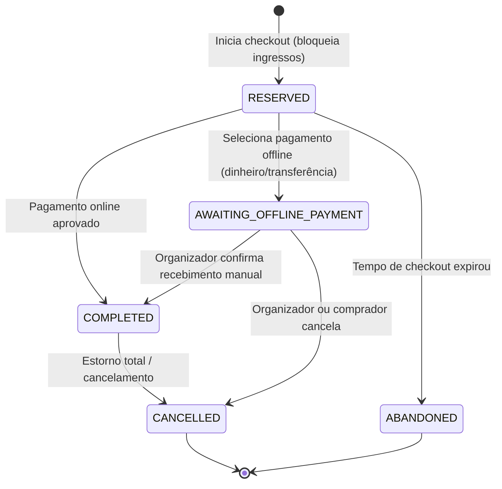
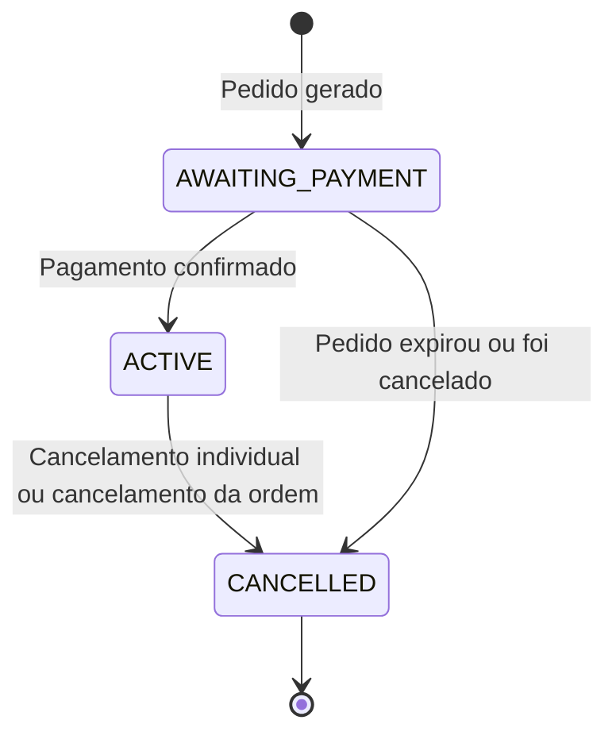
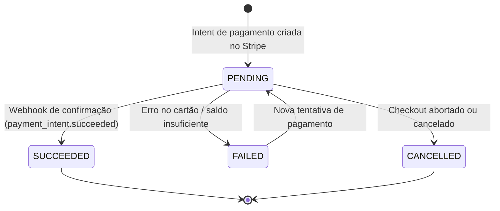
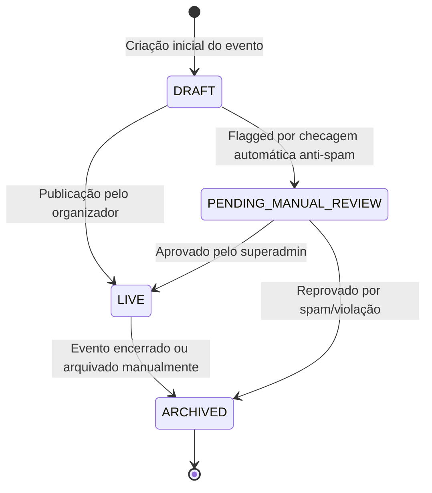

# Máquinas de Estado do Sistema (State Machines)

**Projeto**: Hi.Events  
**Escala de Confiança**: 🟢 CONFIRMADO | 🟡 INFERIDO | 🔴 LACUNA  

---

## 1. Ciclo de Vida do Pedido (`OrderStatus`) 🟢

### Gatilhos e Ações Associadas:
- **`RESERVED`**: Ingressos e assentos ficam bloqueados com timer de expiração.
- **`COMPLETED`**: Emite e envia ingressos por e-mail, aloca assentos como `SOLD`, contabiliza métricas de produtos e afiliados.
- **`ABANDONED` / `CANCELLED`**: Libera assentos e ingressos de volta para o inventário imediatamente.

---

## 2. Ciclo de Vida do Participante (`AttendeeStatus`) 🟢

---

## 3. Ciclo de Vida do Pagamento (`OrderPaymentStatus`) 🟢

---

## 4. Ciclo de Vida do Evento (`EventStatus`) 🟢

