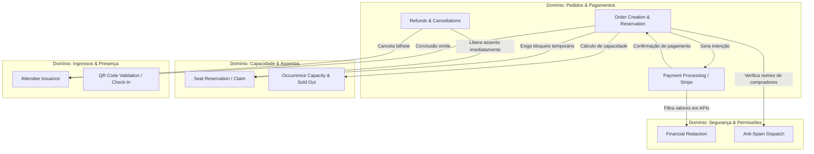

# Matriz de Impacto de Especificações (Spec Impact Matrix)

**Projeto**: Hi.Events  
**Escala de Confiança**: 🟢 CONFIRMADO | 🟡 INFERIDO | 🔴 LACUNA  
**Fonte Técnica**: `.reversa/context/modules.json`, `_reversa_sdd/code-analysis.md`, `_reversa_sdd/domain.md`

---

## 1. Visão Geral da Rastreabilidade e Impacto Cruzado

A **Spec Impact Matrix** mapeia a propagação de mudanças entre os subsistemas do Hi.Events. Quando um módulo ou componente sofre alteração (por evolução ou correção de defeito), esta matriz define quais outros componentes e regras de negócio precisam ser validados para evitar regressão.

---

## 2. Matriz de Impacto Componente × Componente 🟢

| Componente de Origem (Alterado) | Componentes Diretamente Impactados | Efeitos Colaterais Críticos a Validar | Severidade |
|---|---|---|:---:|
| **`Order Domain Service`** | - `Payment Domain Service` - `Seat Claim Service` - `Attendee & Check-In` - `Promo & Affiliate Counters` | - Contadores de promoções e afiliados devem mover apenas em `isOrderCompleted()`. - Expiração de checkout deve liberar assentos e ingressos. - Cancelamento de pedido deve estornar assentos e cancelar participantes. | **CRÍTICA** |
| **`Payment Domain Service`** | - `Order Domain Service` - `Financial Redactor` - `Queue Worker (Webhooks)` | - Webhook de `payment_intent.succeeded` deve comitar antes de disparar e-mails (`afterCommit`). - Reembolso parcial ou total deve disparar `OrderRefund` e atualizar o saldo. - Ocultar valores financeiros caso usuário não tenha `VIEW_FINANCIALS`. | **CRÍTICA** |
| **`Seat Claim Service`** | - `Order Domain Service` - `Event Occurrence Domain` - `Frontend Seating Widget` | - Não permitir venda de produtos sentados sem assento atômico vinculado. - Status de assento (`HELD`, `SOLD`, `BLOCKED`) e ocorrência `SOLD_OUT` não podem ser persistidos em tabela (devem permanecer derivados). | **ALTA** |
| **`Event Occurrence Domain`** | - `Product Pricing Override` - `Order Checkout` - `Capacity Assignment` | - Nunca ler nem gravar em `events.start_date` / `end_date` (usar exclusivamente `event_occurrences`). - Visibilidade de produtos por ocorrência (`ProductOccurrenceVisibility`). | **ALTA** |
| **`Auth & Permissions Guard`** | - `All Http Actions` - `Frontend useAccess()` - `Financial Redactor` | - Usuário sem `EDIT` deve receber `HTTP 403 (READ_ONLY_ROLE)` em rotas mutáveis sem `#[AllowedForReadOnlyUsers]`. - Lookups de IDs filhos em rotas devem ser validados contra o ID do pai autorizado. | **CRÍTICA** |
| **`Anti-Spam & Sanitization`** | - `Organizer Domain` - `Event Publication` - `BaseMail Templates` | - Qualquer texto digitado por usuário que chegue a e-mails não confirmados deve passar por `PersonNameRule`. - Conteúdo HTML de eventos deve ser purificado com `HtmlPurifierService` e renderizado em `sandbox=""` iframe. | **MÉDIA** |
| **`Frontend SSR Context`** | - `Vite SSR Server` - `Public Event Pages` - `React Query Hydration` | - Estado por requisição mantido isolado via `AsyncLocalStorage` (`utilites/ssrRequestContext.ts`). - Rotas públicas devem declarar `handle: { styles: '...' }` em `router.tsx` para evitar CLS. | **ALTA** |

---

## 3. Matriz de Impacto: Domínio × Especificações Funcionais 🟢

---

## 4. Guia de Regressão Obrigatório para Engenheiros e Agentes 🟢

1. **Alterou o fluxo de Checkout / Pedidos?**
   - Execute testes de concorrência de assentos (`tests/Feature/Seating/SeatClaimConcurrencyTest.php`).
   - Verifique se contadores de afiliados e códigos promocionais permanecem intocados até a liquidação final do pagamento.
2. **Alterou rotas de API ou DTOs?**
   - Execute `php artisan api-reference:export` e valide se a documentação OpenAPI gerada reflete exatamente as alterações de contrato.
   - Execute `npx tsc --noEmit` no frontend para garantir que nenhum tipo TypeScript quebrou na camada de consumo React Query.
3. **Alterou e-mails ou mensagens transacionais?**
   - Certifique-se de que o disparo de e-mails via `BaseMail` permaneça associado ao hook `afterCommit()` para não enviar e-mails em transações com rollback.
