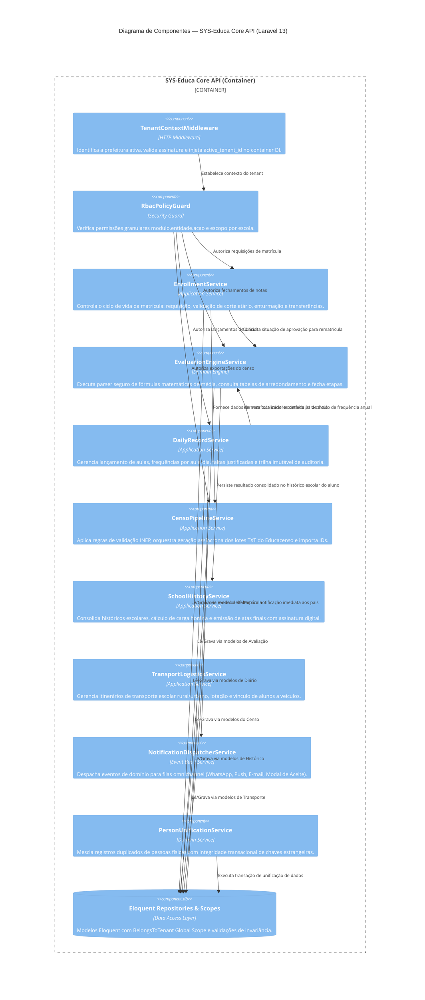

# Modelo C4 — Nível 3: Diagrama de Componentes (Component Diagram)

> **Documento Gerado pelo Agente Architect (`reversa-architect`) — Reversa Framework**  
> **Sistema:** SYSGOV — Gestão Educacional Municipal (`SYS-Educa`)  
> **Container Alvo:** `SYS-Educa Core API` (Laravel 13 Monólito Modular)  
> **Padrão:** C4 Model (Components Level) com Mermaid  
> **Status de Confiança:** 🟢 CONFIRMADO

---

## 1. Visão Geral dos Componentes

O container **SYS-Educa Core API** é estruturado seguindo os princípios de **Domain-Driven Design (DDD)** e arquitetura em camadas (Controllers/HTTP, Application Services, Domain Models/Engines e Repositories/Eloquent). O isolamento entre módulos é garantido por contratos de interface (DTOs e Events) sem dependências circulares.

---

## 2. Diagrama de Componentes (Mermaid)

---

## 3. Descrição das Responsabilidades dos Componentes Centrais

1. **`EvaluationEngineService`:**
   - Desacoplado de controllers web. Recebe como entrada as notas da etapa e as regras cadastradas no banco (`evaluation_rules`), avalia a expressão matemática da fórmula sem `eval` e busca a faixa na tabela de arredondamento (`rounding_rules`), retornando o status de aprovação de forma determinística e testável.
2. **`DailyRecordService`:**
   - Intercepta requisições de diário de classe. Checa a data da aula em relação ao calendário escolar e à tolerância retroativa. Se o período estiver fechado, rejeita lançamentos diretos e exige o fluxo de solicitação de retificação com auditoria.
3. **`CensoPipelineService`:**
   - Coordena a máquina de estados da exportação do Educacenso. Valida primeiro as inconsistências impeditivas e gera relatórios prévios. Ao aprovar, despacha o job assíncrono para a fila do Horizon com paginação estável.
4. **`PersonUnificationService`:**
   - Garante que a mesclagem de duas pessoas físicas (unificação de duplicatas) ocorra em isolamento transacional estrito, migrando todas as 15+ tabelas filhas e gerando log permanente com o antes e depois.
