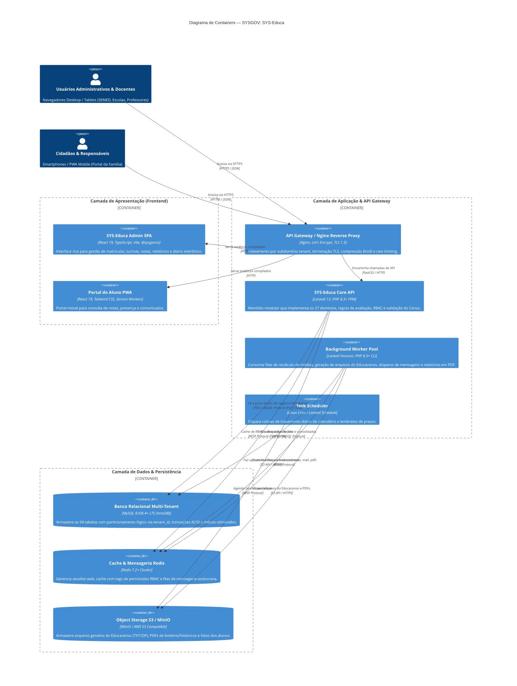

# Modelo C4 — Nível 2: Diagrama de Containers (Container Diagram)

> **Documento Gerado pelo Agente Architect (`reversa-architect`) — Reversa Framework**  
> **Sistema:** SYSGOV — Gestão Educacional Municipal (`SYS-Educa`)  
> **Padrão:** C4 Model (Containers Level) com Mermaid  
> **Status de Confiança:** 🟢 CONFIRMADO

---

## 1. Visão Geral dos Containers

A arquitetura do **SYS-Educa** adota o modelo de **Monólito Modular de Alta Eficiência** em Laravel 13 / PHP 8.3+, com interface rica em SPA React / TypeScript (Design System `@sysgov/ui`), persistência relacional transacional em **MySQL 8.0/8.4+ LTS**, cache e mensageria em **Redis**, armazenamento de artefatos em **S3/MinIO** e observabilidade ponta a ponta com **OpenTelemetry**.

---

## 2. Diagrama de Containers (Mermaid)

---

## 3. Especificação Tecnológica dos Containers

| Container | Tecnologia | Justificativa Arquitetural |
| :--- | :--- | :--- |
| **API Gateway / Nginx** | Nginx Alpine | Roteamento dinâmico de `*.educa.sysgov.br` para identificação de tenant sem reinicialização. |
| **SYS-Educa Core API** | Laravel 13 + PHP 8.3 FPM | Alta produtividade, tipagem estrita, isolamento modular por Domain-Driven Design (DDD) e ecossistema robusto. |
| **Worker Horizon** | Laravel Horizon + Redis | Processamento concorrente resiliente para tarefas pesadas (Censo Escolar, relatórios jasper/snappy e envios de e-mail). |
| **MySQL 8.0/8.4+ LTS** | Percona Server / Oracle MySQL | Padrão corporativo da SYSSTRAT; suporte a CTEs recursivas para estruturas hierárquicas e colunas geradas. |
| **Redis Cache** | Redis 7.2 | Invalidação atômica de permissões e menus (`cache:tags`) e tempo de resposta <2ms para sessões. |
| **Object Storage** | MinIO / S3 | Imutabilidade de relatórios emitidos e documentos comprobatórios com URLs pré-assinadas temporárias. |
