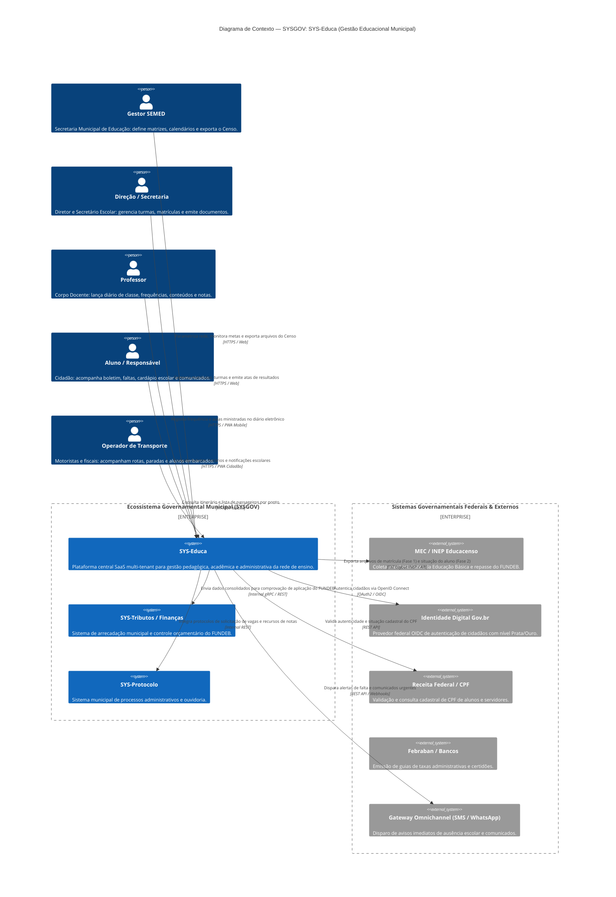

# Modelo C4 — Nível 1: Diagrama de Contexto de Sistema (System Context)

> **Documento Gerado pelo Agente Architect (`reversa-architect`) — Reversa Framework**  
> **Sistema:** SYSGOV — Gestão Educacional Municipal (`SYS-Educa`)  
> **Padrão:** C4 Model (Context Level) com Mermaid  
> **Status de Confiança:** 🟢 CONFIRMADO

---

## 1. Visão Geral do Contexto

O **SYS-Educa** é a plataforma governamental multi-tenant central de gestão escolar dos municípios atendidos pelo ecossistema **SYSGOV**. Ele conecta todos os atores da comunidade escolar (Secretaria de Educação, Gestores Escolares, Docentes, Alunos, Responsáveis e Operadores de Transporte) e interage com sistemas governamentais federais (MEC/INEP, Gov.br, e-Social), bancos e gateways de comunicação.

---

## 2. Diagrama de Contexto (Mermaid)

---

## 3. Descrição das Fronteiras e Relacionamentos

1. **Atores Internos da Educação:**
   - **Gestor SEMED / Diretor / Secretário / Coordenador:** Acessam a suíte completa de gestão administrativa e relatórios com autenticação forte e controle de escopo.
   - **Professor:** Utiliza interface simplificada e rápida (focada em mobile/tablet em sala de aula) para lançamento do diário sem dependência de internet permanente (suporte a sincronização).
   - **Cidadão (Aluno / Responsável):** Acesso com conta Gov.br para verificação de boletim, histórico e comunicados em tempo real.

2. **Integrações de Alto Impacto:**
   - **Educacenso INEP:** Ponto mais sensível de conformidade nacional. O arquivo gerado precisa ser 100% aderente ao layout exigido pelo governo federal.
   - **Gov.br:** Elimina a necessidade de criação de senhas adicionais para os pais e unifica a identidade do cidadão aos demais serviços municipais do SYSGOV.
   - **Gateway Omnichannel:** Transforma o sistema escolar em ferramenta proativa de combate à evasão escolar e ao abandono.
