# Modelo de Entidade e Relacionamento Completo (ERD) — SYS-Educa

> **Documento Gerado pelo Agente Architect (`reversa-architect`) — Reversa Framework**  
> **Sistema:** SYSGOV — Gestão Educacional Municipal (`SYS-Educa`)  
> **Padrão:** Entity-Relationship Diagram (ERD) com Mermaid  
> **Status de Confiança:** 🟢 CONFIRMADO (Consolidação das 94 tabelas modeladas em DDL MySQL 8.0/8.4+)

---

## 1. Visão Geral da Modelagem de Dados

O banco de dados do **SYS-Educa** é estruturado em **MySQL 8.0/8.4+ LTS (InnoDB)**, com padronização de chaves primárias em `CHAR(36)` UUID v7, multi-tenancy nativo com chave estrangeira `tenant_id` em todas as tabelas, codificação `utf8mb4_unicode_ci` e integridade referencial com integridade estrita via chaves estrangeiras (`ON DELETE RESTRICT` nas entidades de negócio permanentes para preservação histórica).

---

## 2. Diagrama Entidade-Relacionamento Completo (Mermaid)

```mermaid
erDiagram
    %% ==========================================
    %% BLOCO 1: NUCLEO INSTITUCIONAL & ESTRUTURA
    %% ==========================================
    tenants ||--o{ institutions : "possui"
    tenants ||--o{ schools : "possui"
    institutions ||--o{ schools : "mantem"
    schools ||--o{ academic_years : "vincula"
    academic_years ||--o{ calendar_periods : "divide-se em"
    schools ||--o{ school_classes : "oferta"
    courses ||--o{ series : "estrutura"
    series ||--o{ curricular_matrices : "adota"
    curricular_matrices ||--o{ matrix_disciplines : "compoe"
    disciplines ||--o{ matrix_disciplines : "pertence"

    %% ==========================================
    %% BLOCO 2: PESSOAS, SERVIDORES & USUARIOS
    %% ==========================================
    tenants ||--o{ people : "cadastra"
    people ||--o| students : "especializa como"
    people ||--o| employees : "especializa como"
    people ||--o| users : "autentica como"
    users }o--o{ roles : "possui papeis via user_roles"
    roles }o--o{ permissions : "possui licencas via role_permissions"
    employees ||--o{ teacher_allocations : "aloca docente"
    schools ||--o{ teacher_allocations : "lotado em"

    %% ==========================================
    %% BLOCO 3: TURMAS, MATRICULAS & ENTURMACAO
    %% ==========================================
    schools ||--o{ school_classes : "compoe"
    academic_years ||--o{ school_classes : "vigente em"
    series ||--o{ school_classes : "pertence a"
    school_classes ||--o{ teacher_allocations : "ministra aula em"
    students ||--o{ enrollments : "possui"
    schools ||--o{ enrollments : "registra"
    academic_years ||--o{ enrollments : "pertence a"
    enrollments ||--o{ class_enrollments : "enturmado em"
    school_classes ||--o{ class_enrollments : "recebe aluno"

    %% ==========================================
    %% BLOCO 4: AVALIACAO, FORMULAS & NOTAS
    %% ==========================================
    evaluation_rules ||--|| media_formulas : "utiliza"
    evaluation_rules ||--|| rounding_tables : "utiliza"
    rounding_tables ||--o{ rounding_rules : "possui faixas"
    series ||--o{ evaluation_rules : "rege avaliacao"
    class_enrollments ||--o{ student_grades : "recebe nota"
    disciplines ||--o{ student_grades : "na disciplina"
    calendar_periods ||--o{ student_grades : "na etapa"
    enrollments ||--o{ enrollment_discipline_summaries : "consolida"
    disciplines ||--o{ enrollment_discipline_summaries : "resumo por"

    %% ==========================================
    %% BLOCO 5: DIARIO DE CLASSE & FREQUENCIA
    %% ==========================================
    school_classes ||--o{ daily_records : "registra aula"
    disciplines ||--o{ daily_records : "na materia"
    employees ||--o{ daily_records : "ministrado por"
    daily_records ||--o{ daily_attendance : "apura presenca"
    class_enrollments ||--o{ daily_attendance : "do aluno"
    daily_attendance ||--o| attendance_excuses : "justifica com"
    daily_records ||--o{ daily_record_audit_logs : "audita mudanca"

    %% ==========================================
    %% BLOCO 6: CENSO ESCOLAR, TRANSPORTE & LOGS
    %% ==========================================
    schools ||--o{ censo_exports : "exporta lote"
    censo_exports ||--o{ censo_batches : "contem arquivos"
    tenants ||--o{ transport_routes : "cria rota"
    transport_routes ||--o{ transport_passengers : "transporta"
    students ||--o{ transport_passengers : "utiliza onibus"
    transport_vehicles ||--o{ transport_routes : "executa rota"
    users ||--o{ notifications : "recebe"
    users ||--o{ audit_logs : "gera rastro"

    %% ==========================================
    %% ATRIBUTOS DAS TABELAS CHAVE
    %% ==========================================
    tenants {
        char(36) id PK
        varchar(100) name
        varchar(20) cnpj
        enum status
    }
    schools {
        char(36) id PK
        char(36) tenant_id FK
        varchar(14) inep_code
        varchar(150) name
    }
    academic_years {
        char(36) id PK
        char(36) tenant_id FK
        int year
        enum status
    }
    school_classes {
        char(36) id PK
        char(36) school_id FK
        char(36) academic_year_id FK
        varchar(100) name
        int max_capacity
    }
    people {
        char(36) id PK
        char(36) tenant_id FK
        varchar(200) full_name
        varchar(11) cpf
        date birth_date
    }
    students {
        char(36) id PK
        char(36) person_id FK
        varchar(12) inep_id
        varchar(100) sus_card
    }
    enrollments {
        char(36) id PK
        char(36) student_id FK
        char(36) school_id FK
        char(36) academic_year_id FK
        enum status
        date enrollment_date
    }
    class_enrollments {
        char(36) id PK
        char(36) enrollment_id FK
        char(36) school_class_id FK
        int call_number
    }
    student_grades {
        char(36) id PK
        char(36) class_enrollment_id FK
        char(36) discipline_id FK
        char(36) calendar_period_id FK
        decimal(5_2) grade_value
        varchar(5) concept_value
    }
    daily_records {
        char(36) id PK
        char(36) school_class_id FK
        char(36) discipline_id FK
        date lesson_date
        int lesson_count
        enum status
    }
    daily_attendance {
        char(36) id PK
        char(36) daily_record_id FK
        char(36) class_enrollment_id FK
        enum status
        decimal(4_2) absence_count
    }
```

---

## 3. Dicionário de Integridade Referencial

1. **Garantia de Não-Orfandade:**
   - Registros de notas (`student_grades`) e frequências (`daily_attendance`) possuem vínculo estrito com `class_enrollments`. Se uma turma é reorganizada, o vínculo com a matrícula permanece auditado.
2. **Histórico Permanente:**
   - Tabelas de encerramento (`enrollment_discipline_summaries` e `school_histories`) armazenam snapshots desnormalizados da carga horária e das notas finais obtidas no momento da conclusão do ano letivo, garantindo que alterações em matrizes futuras não alterem históricos passados.
