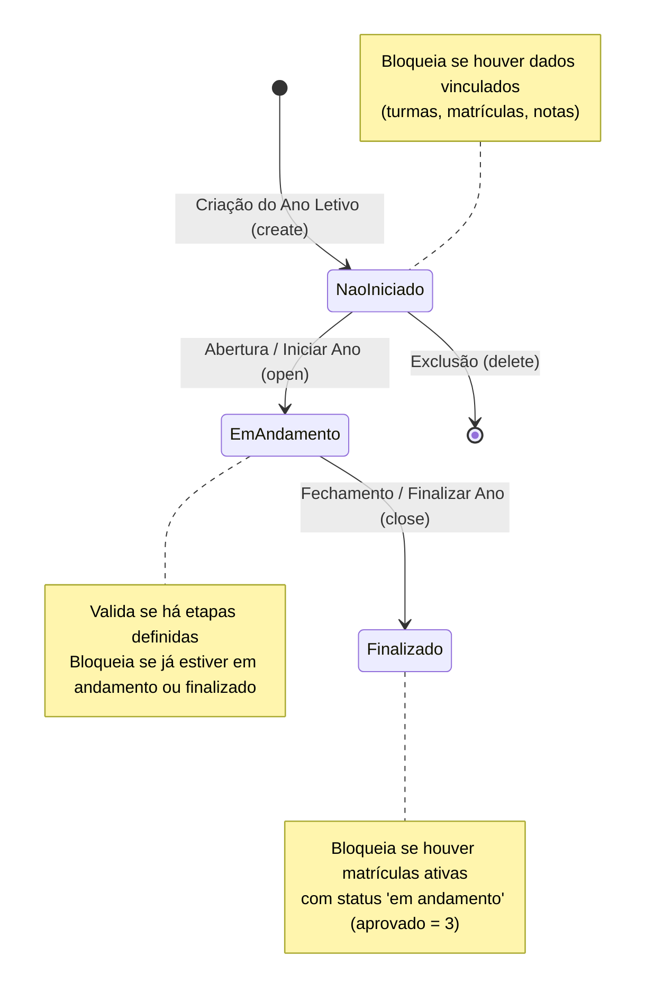
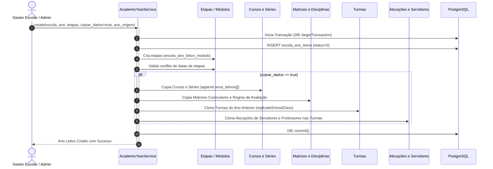

# Fluxos de Controle — Módulo AcademicYear (Ano Letivo)

> Gerado pelo Reversa Archaeologist (doc_level: completo) em 2026-10-12

---

## 1. Ciclo de Vida e Transições de Estado do Ano Letivo

O ano letivo possui 3 estados fundamentais definidos em `app/Services/AcademicYearService.php`:
- `0`: Não iniciado (`STATUS_NOT_STARTED`)
- `1`: Em andamento (`STATUS_IN_PROGRESS`)
- `2`: Finalizado (`STATUS_FINISHED`)



---

## 2. Fluxo de Criação e Cópia de Dados do Ano Anterior

Quando um novo ano letivo é criado com a opção `copiar_dados = true`, o método `performDataCopy` (ou `executeCopyAcademicYears`) executa um fluxo transacional complexo:



---

## 3. Validação de Fechamento do Ano Letivo (`close`)

Regras rígidas impedem o encerramento indevido do ano:

```mermaid
flowchart TD
    Start([Início do Fechamento do Ano]) --> CheckStatus{Status atual == 1 (Em andamento)?}
    CheckStatus -- Não --> ErrStatus[Lança Exceção: Ano não está em andamento]
    CheckStatus -- Sim --> CheckEnrollments{Existem matrículas com aprovado == 3?}
    
    CheckEnrollments -- Sim --> CheckActivity{É apenas atividade complementar?}
    CheckActivity -- Não --> ErrEnrollments[Lança Exceção: Existem alunos com situação indefinida/em andamento]
    CheckActivity -- Sim --> UpdateStatus[Atualiza status = 2 (Finalizado)]
    
    CheckEnrollments -- Não --> UpdateStatus
    UpdateStatus --> TriggerEvents[Dispara eventos de encerramento]
    TriggerEvents --> End([Ano Finalizado com Sucesso])
```
