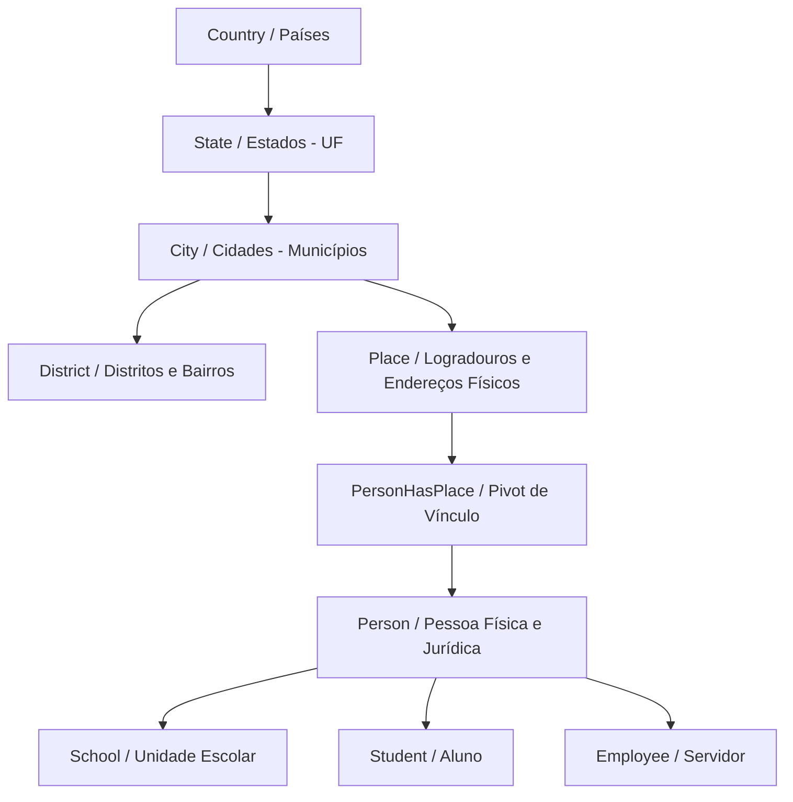

# Fluxos de Controle — Módulo Addressing (Endereçamento e Geografia)

> Gerado pelo Reversa Archaeologist (doc_level: completo) em 2026-10-12

---

## 1. Hierarquia Geográfica e Relacionamentos

O modelo de endereçamento do sistema segue uma árvore estrita de dados geográficos:



---

## 2. Validações e Travas de Integridade Referencial na Exclusão

Regras de negócio implementadas nos FormRequests e Rules da API impedem a exclusão em cascata acidental:

```mermaid
flowchart TD
    Req([Tentativa de Excluir Cidade]) --> CheckPerm{Usuário tem permissão (Processo 755)?}
    CheckPerm -- Não --> ErrPerm[403 Proibido / Acesso Negado]
    CheckPerm -- Sim --> CheckDistricts{Possui Distritos/Bairros vinculados?}
    CheckDistricts -- Sim --> ErrDistricts[Erro: Não é possível excluir cidade com bairros vinculados]
    CheckDistricts -- Não --> CheckPlaces{Possui Endereços/Places vinculados?}
    CheckPlaces -- Sim --> ErrPlaces[Erro: Não é possível excluir cidade com endereços vinculados]
    CheckPlaces -- Não --> DoDelete[Exclusão da Cidade Concluída]
```
