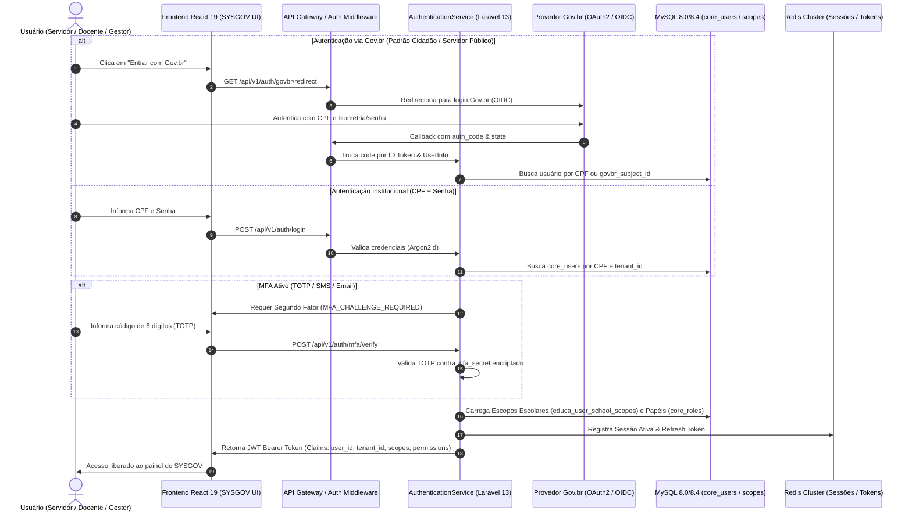
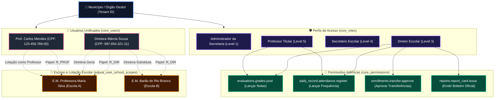
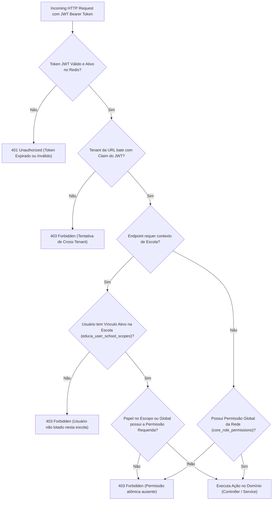

# Fluxo Arquitetural: Perfis de Acesso, Autenticação e Permissões RBAC (SYSGOV - Usuario)

Este documento modela a arquitetura de **Autenticação, Autorização e Gestão de Escopos Escolares** do **SYSGOV (SYS-Educa)**, superando o acoplamento do legado do i-Educar (`pmieducar.usuario`, `portal.funcionario`, `portal.acesso`, `pmieducar.tipo_usuario`, `pmieducar.menu_tipo_usuario`, `pmieducar.usuario_escola`).

---

## 1. Fluxo de Autenticação Unificada (Gov.br / MFA / JWT)

---

## 2. Matriz RBAC Hierárquica e Resolução de Escopo Escolar

---

## 3. Decisão de Autorização por Requisição (RBAC + Contextual Scope Middleware)

