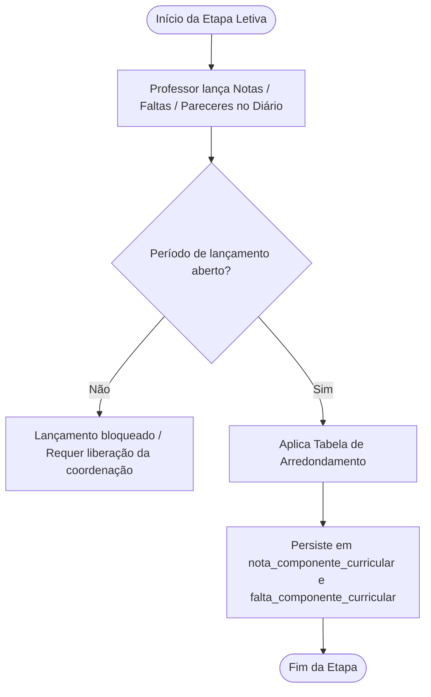
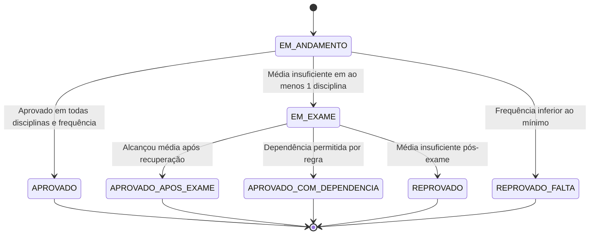

# Fluxos de Controle — Módulo Avaliacao (Regras de Avaliação, Notas e Frequência)

> Gerado pelo Reversa Archaeologist (doc_level: completo) em 2026-10-12

---

## 1. Ciclo de Vida da Avaliação e Lançamento por Etapa

O processo de registro pedagógico durante o ano letivo segue o fluxo de etapas (bimestres/trimestres):



---

## 2. Motor de Cálculo de Situação Final do Aluno (`Boletim.php`)

Consolidação final executada ao término do período letivo pelo método `getSituacaoAluno()`:

```mermaid
flowchart TD
    Calculo([Fechamento do Ano / Cálculo de Média]) --> CalcMedias[Calcula Médias Finais via FormulaMedia]
    CalcMedias --> CheckPresenca{Presença >= % Mínimo da Regra (ex: 75%)?}
    CheckPresenca -- Não --> ReprovadoFalta[REPROVADO POR FALTA]
    CheckPresenca -- Sim --> CheckMedia{Média Final >= Média de Aprovação (ex: 7.0)?}
    
    CheckMedia -- Sim --> AprovadoDireto[APROVADO]
    CheckMedia -- Não --> CheckExame{Média Final >= Média Mínima para Exame?}
    
    CheckExame -- Não --> ReprovadoNota[REPROVADO POR NOTA]
    CheckExame -- Sim --> EmExame[EM EXAME / RECUPERAÇÃO FINAL]
    
    EmExame --> RealizaExame[Lançamento da Nota do Exame Final]
    RealizaExame --> RecalculaMedia[Aplica formulaRecuperacao]
    RecalculaMedia --> CheckNovaMedia{Nova Média >= Média Pós-Exame (ex: 5.0)?}
    
    CheckNovaMedia -- Sim --> AprovadoExame[APROVADO APÓS EXAME]
    CheckNovaMedia -- Não --> CheckDependencia{Regra permite dependência e Disciplinas <= Limite?}
    CheckDependencia -- Sim --> AprovadoDep[APROVADO COM DEPENDÊNCIA]
    CheckDependencia -- Não --> ReprovadoFinal[REPROVADO]
```

---

## 3. Matriz de Prioridade de Situação da Matrícula

O sistema aplica uma máquina de estados com precedência estrita para determinar o status global:


