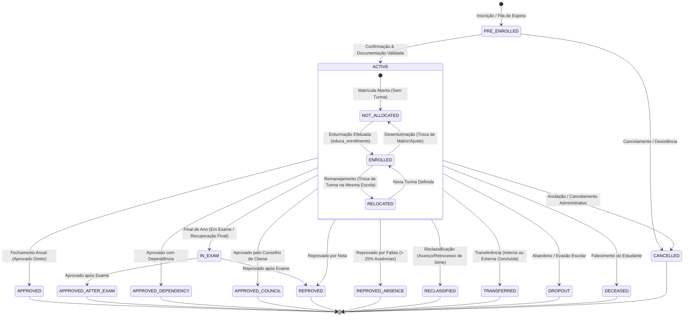
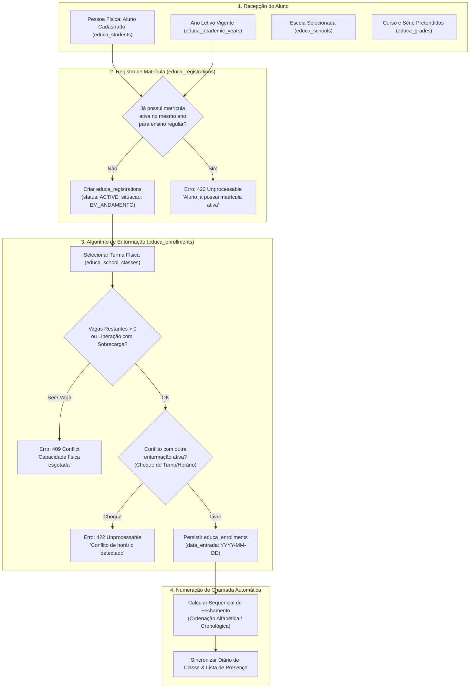
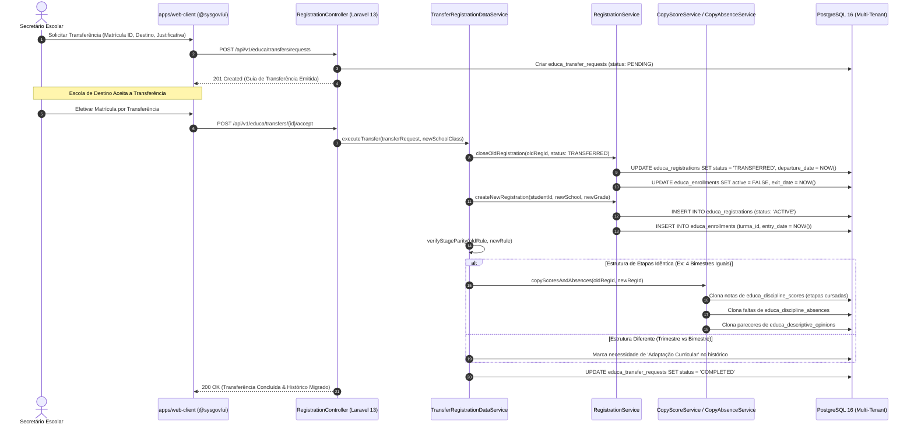

# Fluxograma Arquitetural — Ciclo de Vida da Matrícula e Enturmação (SYS-Educa / SYSGOV)

> **Módulos:** `Registration` e `Enrollments`  
> **Contexto:** Gestão completa do ciclo de vida acadêmico do aluno: ingresso, matrícula ativa, alocação em turmas (`enturmação`), remanejamento interno, transferências (internas e externas), reclassificação, abandono, reordenação de chamada e encerramento anual.

---

## 1. Máquina de Estados da Matrícula (`educa_registrations`)

No i-Educar legado (`pmieducar.matricula`), a situação da matrícula (`MatriculaSituacao`) operava com inteiros mágicos. No **SYS-Educa**, padronizamos com Enums tipados e mapeamento direto ao Censo Escolar/MEC.

---

## 2. Fluxo Operacional: Matrícula e Alocação Física (`educa_enrollments`)

Distinção fundamental entre **Matrícula** (relação contratual do estudante com a escola/série/ano) e **Enturmação** (alocação do estudante numa turma física com carteira, turno e número de chamada).

---

## 3. Diagrama de Sequência: Transferência com Portabilidade de Avaliações

O processo de transferência interna ou externa requer a preservação do histórico de notas, faltas e pareceres do estudante (`TransferRegistrationDataService`), caso as matrizes e etapas de ensino coincidam.

---

## 4. Matriz de Situações da Matrícula e Equivalências

| ID Legado | Situação Legada (`pmieducar.matricula.aprovado`) | Enum SYS-Educa (`RegistrationStatus`) | Terminal? | Bloqueia Enturmação? | Gera Histórico? |
|:---:|:---|:---|:---:|:---:|:---:|
| `1` | Aprovado | `APPROVED` | Sim | Sim | Sim |
| `2` | Reprovado | `REPROVED` | Sim | Sim | Sim |
| `3` | Em Andamento | `ACTIVE` | Não | Não (Exige Enturmação) | Não |
| `4` | Transferido | `TRANSFERRED` | Sim | Sim | Sim (Parcial) |
| `5` | Reclassificado | `RECLASSIFIED` | Sim | Sim | Sim |
| `6` | Abandono | `DROPOUT` | Sim | Sim | Sim (Interrompido)|
| `7` | Em Exame | `IN_EXAM` | Não | Não | Não |
| `8` | Aprovado após Exame | `APPROVED_AFTER_EXAM` | Sim | Sim | Sim |
| `11` | Pré-Matrícula | `PRE_ENROLLED` | Não | Sim (Até Confirmação) | Não |
| `12` | Aprovado com Dependência | `APPROVED_DEPENDENCY` | Sim | Sim | Sim |
| `13` | Aprovado pelo Conselho | `APPROVED_COUNCIL` | Sim | Sim | Sim |
| `14` | Reprovado por Faltas | `REPROVED_ABSENCE` | Sim | Sim | Sim |
| `15` | Falecido | `DECEASED` | Sim | Sim | Não |
| `-` | Cancelado / Anulado | `CANCELLED` | Sim | Sim | Não |
