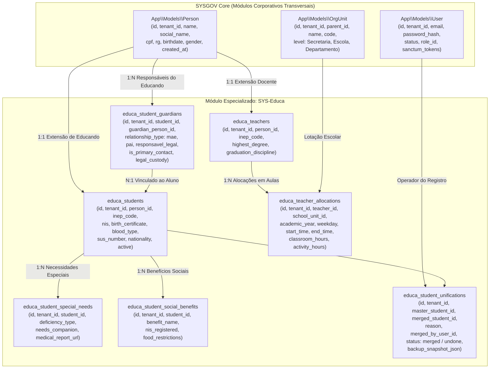
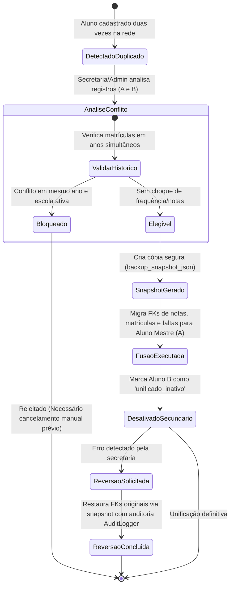
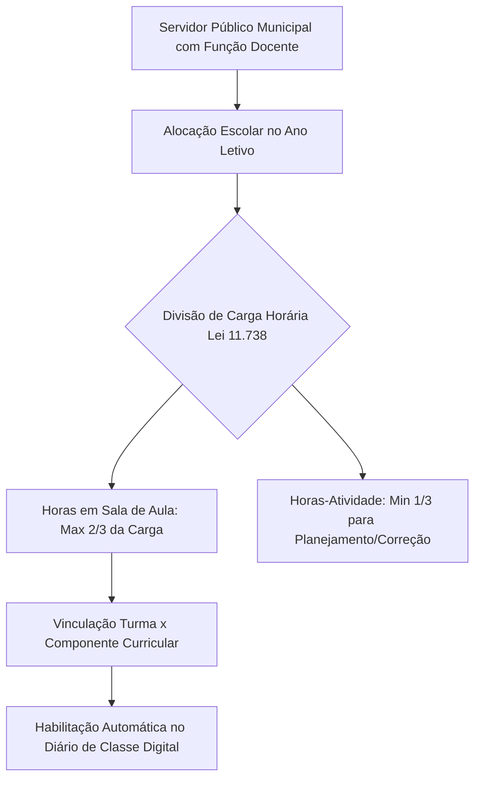

# Fluxograma de Dados e Entidades: Pessoas, Estudantes e Servidores (SYS-Educa vs SYSGOV Core)

> Mapeamento de Transição do I-Educar para o SaaS SYSGOV
> Módulos Legados: `Cadastro`, `People`, `Servidores`, `Unification`
> Padrão: Mermaid + JetBrains Mono

---

## 1. Topologia de Entidades: Unificação com os Módulos Comuns do SYSGOV

---

## 2. Máquina de Estados e Regras da Fusão/Unificação de Alunos (`StudentUnification`)

---

## 3. Matriz de Atribuições Pedagógicas do Docente (Lotação LDB)

