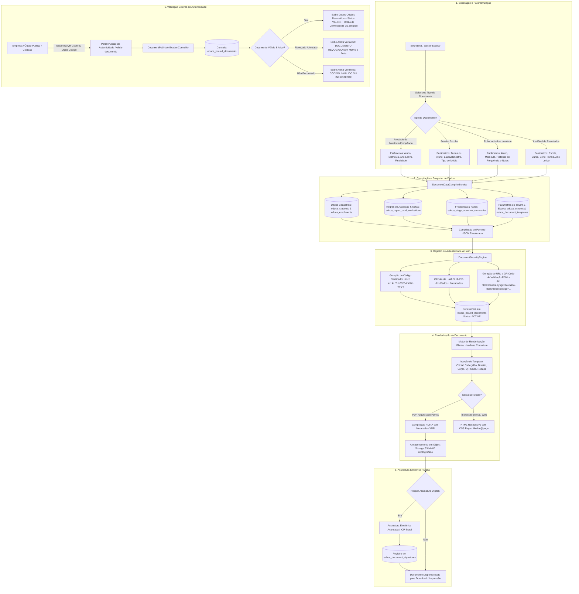

# Fluxo de Emissão e Validação de Documentos e Relatórios Oficiais (Reports & Official Documents)

Este diagrama modela o ciclo de vida da geração de documentos escolares oficiais (Atestados, Boletins, Fichas Individuais, Atas de Resultados Finais), o processo de assinatura digital, a fixação de autenticidade documental pública via QR Code / Hash SHA-256 e a consulta pública por terceiros no submódulo `SYS-Educa` do **SYSGOV**.

## Destaques da Arquitetura SYSGOV vs Legado

1. **Eliminação do Servidor Java JasperReports**:
   - O legado dependia de arquivos `.jrxml` e chamadas HTTP síncronas a um daemon Java instável (`ReportFactoryPHPJasper` ou serviço remoto).
   - O **SYSGOV** utiliza templates Blade modernos com CSS Paged Media (`@page`) e renderização determinística via Chromium Headless (Gotenberg / Browsershot), permitindo tanto geração de PDF/A de altíssima fidelidade quanto impressão instantânea via navegador.
2. **Rastreabilidade e Autenticidade Pública (Inovação)**:
   - No legado, a impressão de documentos gerava PDFs voláteis sem persistência de via ou verificação pública.
   - O **SYSGOV** grava cada emissão na tabela `educa_issued_documents` com hash SHA-256 e código alfanumérico único. Um QR Code impresso no documento permite que qualquer terceiro (cartórios, consulados, empresas, outras secretarias) confirme a validade do documento em tempo real sem intermediários.
3. **Assinatura Eletrônica Integrada**:
   - Suporte nativo a assinaturas eletrônicas (`educa_document_signatures`) por diretores e secretários escolares, atendendo aos requisitos da Lei Federal nº 14.063/2020 e carimbo de tempo.
