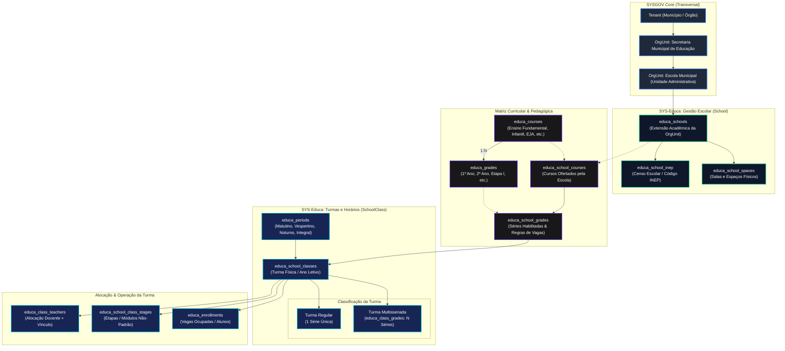
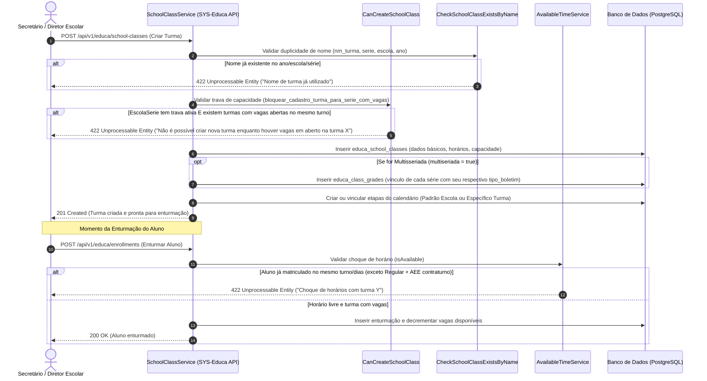

# Fluxograma Arquitetural — Estrutura Escolar e Turmas (SYS-Educa / SYSGOV)

> **Módulos:** `School` e `SchoolClass`  
> **Contexto:** Mapeamento da hierarquia escolar, cursos, séries, turnos, matriz de oferta por unidade e enturmação (regular e multisseriada).

---

## 1. Visão Geral da Hierarquia Organizacional e Acadêmica

---

## 2. Ciclo de Vida e Regras de Validação de Turmas

---

## 3. Matriz de Turnos e Regras de Compatibilidade de Horários

| Turno (`educa_periods`) | Horário Padrão | Validação de Conflito no Aluno | Exceção Permitida |
| :--- | :--- | :--- | :--- |
| **Matutino** | 07:00 – 12:00 | Não pode coincidir com outra matrícula no mesmo turno | Pode cursar AEE no Vespertino |
| **Vespertino** | 13:00 – 18:00 | Não pode coincidir com outra matrícula no mesmo turno | Pode cursar AEE no Matutino |
| **Noturno** | 18:30 – 22:30 | Não pode coincidir com outra matrícula regular | Compatível com estágios/trabalho |
| **Integral** | 07:30 – 17:00 | Bloqueia qualquer outra enturmação concomitante | AEE integrado no plano de atendimento |
