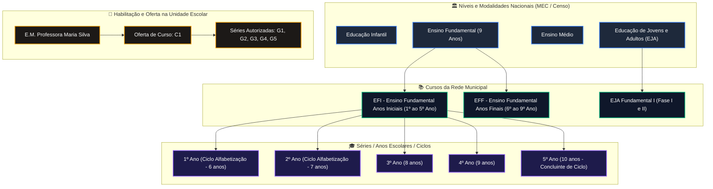
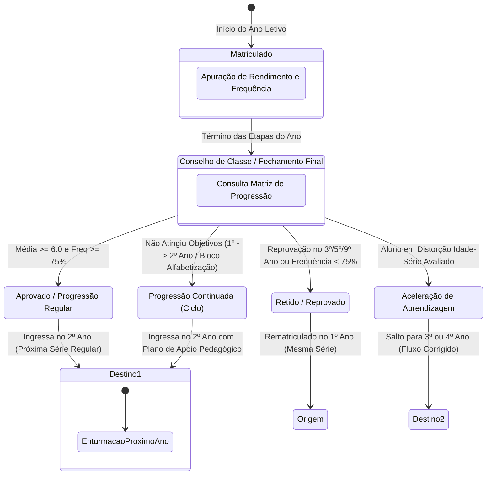

# Fluxo Arquitetural: Etapas de Ensino, Cursos, Séries, Ciclos e Matriz de Progressão (SYSGOV - Stages)

Este documento modela a taxonomia educacional do **SYSGOV (SYS-Educa)**, superando o acoplamento procedural do legado do i-Educar (`pmieducar.curso`, `pmieducar.serie`, `pmieducar.sequencia_serie`, `pmieducar.modulo`).

---

## 1. Hierarquia da Estrutura Curricular e Escolar

---

## 2. Motor de Matriz de Progressão Continuada e Transição (`educa_grade_sequences`)

