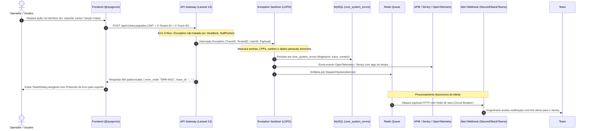
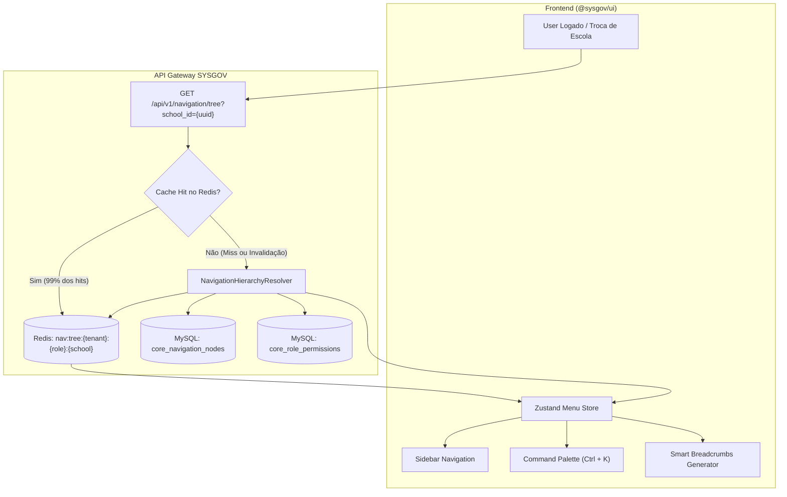
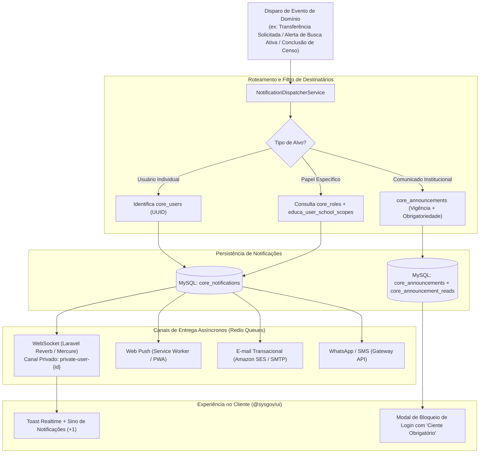

# 🧭 Fluxos de Arquitetura: Módulos de Suporte (ErrorTracking, Navigation, Notifications)

> **Módulos:** `ErrorTracking`, `Navigation`, `Notifications`  
> **Status:** Especificado e Aprovado para SYSGOV (`SYS-Educa`)  
> **Data:** 2026-10-12  

---

## 1. Fluxo de Captura, Sanitização e Rastreamento de Erros (ErrorTracking & APM)

---

## 2. Fluxo de Resolução Hierárquica e Cache de Menus (Navigation & Command Palette)

---

## 3. Fluxo de Notificações Omnichannel e Avisos Obrigatórios (Notifications & Announcements)

