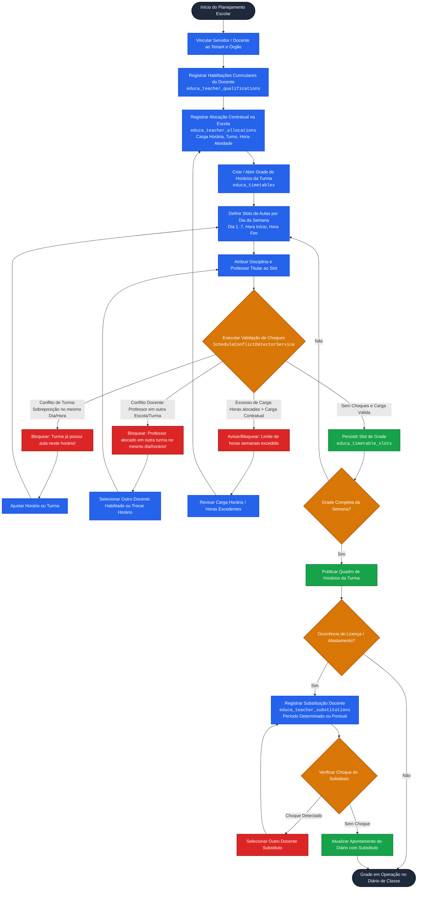

# Fluxograma: Gestão de Quadro de Horários, Alocação Docente e Prevenção de Choques

> **Módulo:** `Quadro de Horários e Alocação Docente` (`Timetable` / `Servidores / Alocação`)  
> **Sistema Alvo:** `SYSGOV` / `SYS-Educa`  
> **Engine de Banco de Dados:** `MySQL 8.0/8.4+ (InnoDB)`

---

## 1. Ciclo de Vida: Da Alocação Docente à Matriz de Choque de Horários



---

## 2. Algoritmo de Detecção de Choque de Horários (Overlap Detection)

```mermaid
flowchart LR
    classDef check fill:#0284c7,stroke:#0369a1,stroke-width:2px,color:#fff;
    classDef cond fill:#f59e0b,stroke:#d97706,stroke-width:2px,color:#fff;
    classDef res fill:#10b981,stroke:#059669,stroke-width:2px,color:#fff;
    classDef err fill:#ef4444,stroke:#dc2626,stroke-width:2px,color:#fff;

    Input[Novo Slot Solicitado:<br/>Professor: P, Turma: T, Dia: D<br/>Intervalo: H_ini_novo .. H_fim_novo]:::check --> QueryDB[Consultar Slots Ativos Existentes:<br/>Tenant = ID, Ano Letivo = Ano, Dia = D]:::check

    QueryDB --> ClassOverlap{Existe Slot na mesma Turma T onde:<br/>H_ini_novo < H_fim_existente AND<br/>H_fim_novo > H_ini_existente?}:::cond
    ClassOverlap -->|Sim| ErrClass[ERRO: Choque de Horário na Turma]:::err

    ClassOverlap -->|Não| TeacherOverlap{Existe Slot ativo com Professor P onde:<br/>H_ini_novo < H_fim_existente AND<br/>H_fim_novo > H_ini_existente?}:::cond
    TeacherOverlap -->|Sim| ErrTeacher[ERRO: Choque de Horário do Docente<br/>(Conflito com Turma X na Escola Y)]:::err

    TeacherOverlap -->|Não| WorkloadCheck{Soma Horas-Aula Docente + Slot<br/>> Carga Horária Contratual Escola?}:::cond
    WorkloadCheck -->|Sim| WarnWorkload[ALERTA / BLOQUEIO:<br/>Extrapolação de Carga Horária]:::err
    WorkloadCheck -->|Não| AllowSave[HORÁRIO VÁLIDO:<br/>Gravação Aprovada com Sucesso]:::res
```
