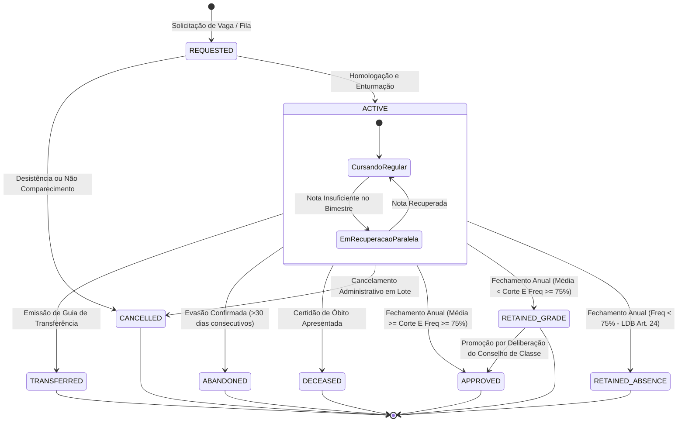
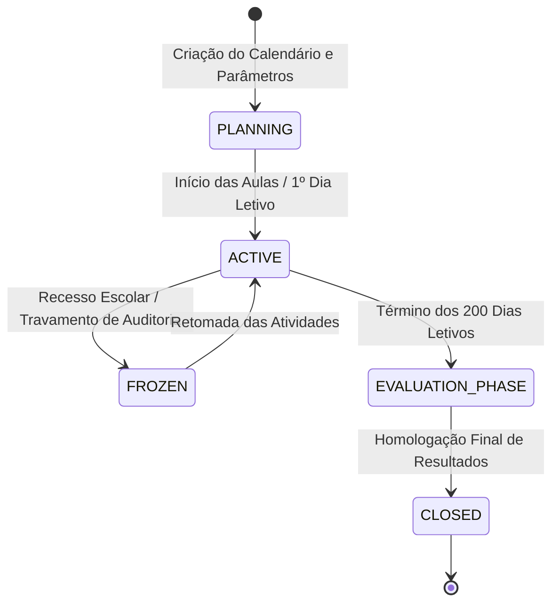
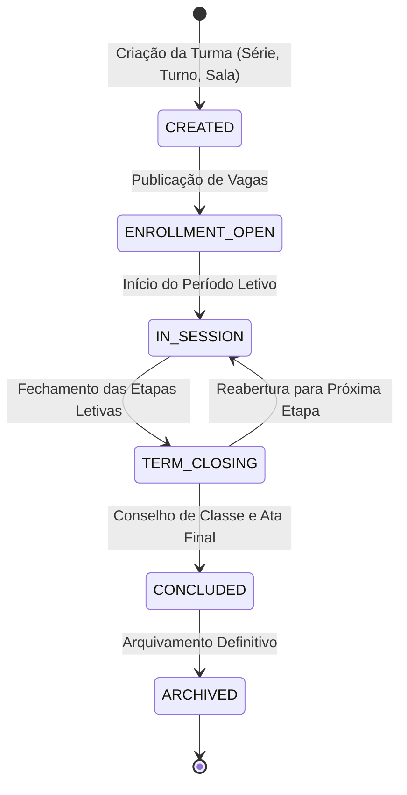
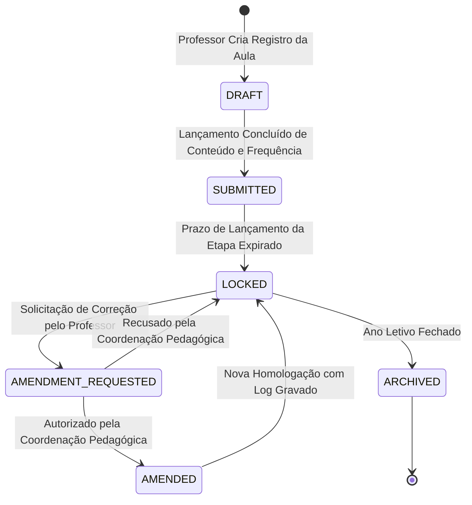
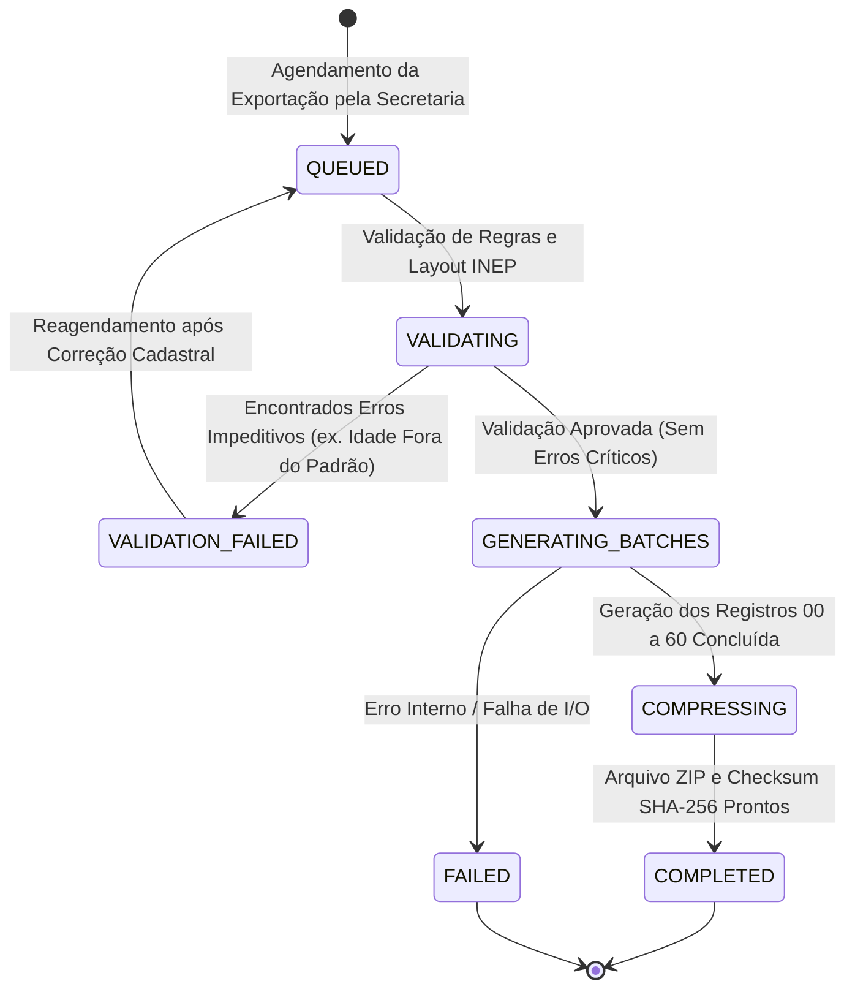
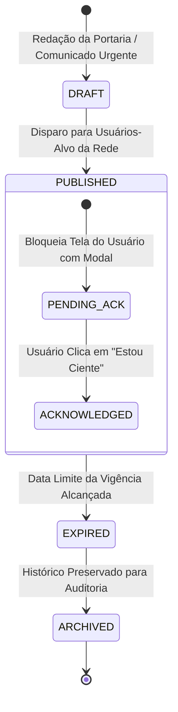

# Máquinas de Estado do Domínio Educacional — SYS-Educa

> **Documento Gerado pelo Agente Detective (`reversa-detective`) — Reversa Framework**  
> **Nível de Documentação:** `completo`  
> **Sistema Alvo:** SYSGOV — Gestão Educacional Municipal (`SYS-Educa`)  
> **Status de Confiança:** 🟢 CONFIRMADO (regras estritas de transição extraídas do código legado)

---

## 1. Visão Geral das Máquinas de Estado

O ciclo de vida educacional é governado por transições de estado bem delimitadas por prazos legais, deliberações de conselho e ações administrativas. No SYS-Educa, todas as transições de estado são tratadas como **eventos de domínio explícitos**, impedindo alterações diretas e não rastreadas no banco de dados.

---

## 2. Máquina de Estados: Matrícula Escolar (`Enrollment`)

A matrícula é o vínculo jurídico central entre o aluno e a instituição de ensino.

### 2.1. Tabela de Estados e Descrições

| Estado | Nome Canônico | Descrição |
| :--- | :--- | :--- |
| `REQUESTED` | Solicitada / Pré-matrícula | Inscrição realizada no portal ou fila de espera, aguardando validação de documentos pela secretaria. |
| `ACTIVE` | Cursando / Regular | Aluno com documentação homologada e frequente nas aulas da turma. |
| `TRANSFERRED` | Transferido | Matrícula encerrada por solicitação de transferência para outra escola ou município. Vaga liberada. |
| `ABANDONED` | Abandono Escolar | Constatada evasão escolar após esgotadas as notificações de busca ativa e intervenção do Conselho Tutelar. |
| `DECEASED` | Falecido | Encerramento definitivo do vínculo por óbito do educando. |
| `CANCELLED` | Cancelada | Anulação administrativa da matrícula por duplicidade ou não comparecimento no prazo legal de início. |
| `APPROVED` | Aprovado | Aluno atingiu os critérios de média e frequência mínima estabelecidos pelo regimento escolar. |
| `RETAINED_GRADE` | Reprovado por Nota | Aluno com frequência adequada (>75%), porém com média final inferior à média de corte do município. |
| `RETAINED_ABSENCE`| Reprovado por Infrequência | Aluno com frequência total inferior a 75% da carga horária, conforme art. 24, VI da LDB. |

### 2.2. Diagrama de Transição de Estados (Mermaid)

---

## 3. Máquina de Estados: Ano Letivo (`AcademicYear`)

O ano letivo dita a abertura de matrículas, diários de classe e validação de relatórios oficiais.

### 3.1. Diagrama de Transição de Estados (Mermaid)

### 3.2. Regras de Invariância:
- **Transição `PLANNING` → `ACTIVE`:** Exige no mínimo uma etapa de calendário cadastrada e turmas configuradas com matrizes curriculares ativas.
- **Transição `EVALUATION_PHASE` → `CLOSED`:** Bloqueada caso existam diários de classe pendentes de lançamento ou notas não informadas sem justificativa de dispensa.
- **Estado `CLOSED`:** Torna 100% dos registros de notas, faltas, diários e turmas daquele ano em modo somente-leitura definitiva (`is_immutable = TRUE`).

---

## 4. Máquina de Estados: Turma Escolar (`SchoolClass`)

### 4.1. Diagrama de Transição de Estados (Mermaid)

---

## 5. Máquina de Estados: Diário de Classe (`DailyRecord`)

Garante a fé pública e a rastreabilidade das anotações de aula do corpo docente.

### 5.1. Diagrama de Transição de Estados (Mermaid)

---

## 6. Máquina de Estados: Exportação do Educacenso INEP (`CensoExportJob`)

### 6.1. Diagrama de Transição de Estados (Mermaid)

---

## 7. Máquina de Estados: Comunicado Oficial Obrigatório (`MandatoryNotification`)

### 7.1. Diagrama de Transição de Estados (Mermaid)

