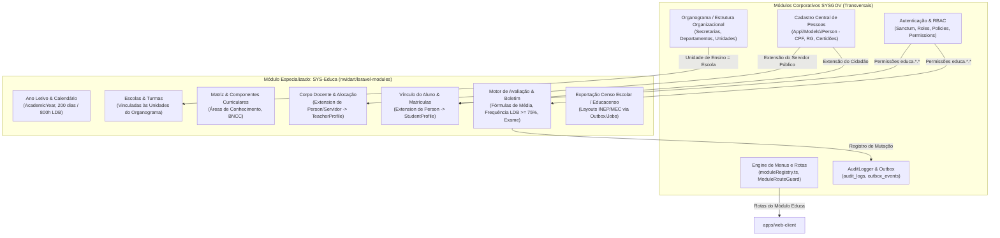

# Arquitetura Alvo: Módulo SYS-Educa no SaaS SYSGOV

> Documento de Referência Estratégica e Diretrizes de Engenharia para a Reconstrução do I-Educar no Ecossistema SYSGOV.
> Versão: 1.0.0 — Data: 2026-10-12
> Padrão Visual e Técnico: SYSGOV Canônico (`AGENTS.md`, `DESIGN_SYSTEM.md`, JetBrains Mono para termos técnicos).

---

## 1. Visão Geral e Posicionamento do SYS-Educa

O **SYS-Educa** é o módulo vertical de Gestão Escolar e Educação Pública do **SYSGOV**, o SaaS multi-tenant de governança e gestão pública da SYSTRAT.

```
┌────────────────────────────────────────────────────────────────────────────┐
│                              SYSGOV SaaS Monorepo                          │
├────────────────────────────────────────────────────────────────────────────┤
│  apps/api (Laravel 13, PHP 8.4, nwidart/laravel-modules, Port 8000)         │
│  apps/web (Painel Admin - React 19 + TS + Tailwind v4, Port 5173 - Navy)   │
│  apps/web-client (Painel Órgão Público - React 19 + TS - Port 5174 - GOV.BR│
│  packages/ui (@sysgov/ui - shadcn/ui + Radix + CVA)                        │
│  packages/sdk (@sysgov/sdk - Contratos e Tipos TypeScript)                │
└────────────────────────────────────────────────────────────────────────────┘
```

### Princípio Fundamental de Reconstrução
O I-Educar legado acumulou mais de 15 anos de regras específicas da educação brasileira (LDB, Censo Escolar/INEP, matrizes curriculares, fórmulas de cálculo de médias, progressão continuada, dependência de disciplinas, enturmação). 
No entanto, o legado também carregava código legado monolítico (PHP procedural misturado com procedural SQL de PostgreSQL), cadastros próprios de pessoas físicas e funcionários, controle de acesso arcaico e replicação de dados geográficos.

**A estratégia SYSGOV consiste em:**
1. **Reaproveitar integralmente os serviços horizontais do SYSGOV** (Pessoas, Autenticação/RBAC, Organograma, Menus, Auditoria, Outbox, Multi-tenant).
2. **Extrair e refatorar em código limpo o "Core de Gestão Escolar" do I-Educar** (Motor de Avaliação, Regras da LDB, Calendário Letivo, Matrículas, Diário de Classe, Censo INEP).

---

## 2. Mapeamento de Integração com os Módulos Comuns do SYSGOV



### 2.1. Cadastro de Pessoas (`Person`)
- **No I-Educar legado:** Tabelas separadas e redundantes (`cadastro.pessoa`, `cadastro.fisica`, `cadastro.juridica`, `cadastro.documento`).
- **No SYS-Educa:** 
  - Toda pessoa (aluno, pai, mãe, responsável legal, professor, motorista de transporte escolar) é representada pelo Model corporativo do SYSGOV: `App\Models\Person`.
  - O módulo `Educa` cria tabelas de extensão que referenciam `person_id` com chave estrangeira e `tenant_id`:
    - `educa_students`: Guarda dados escolares do educando (NIS, código INEP, necessidades educacionais especiais/AEE, autorização de uso de imagem, restrições alimentares).
    - `educa_guardians`: Relacionamento entre `student_person_id` e `guardian_person_id` com grau de parentesco (`parentesco_tipo`), guarda judicial e contatos de emergência.
    - `educa_teachers`: Extensão com formação pedagógica, habilitação docente e código INEP do docente.
  - **Vantagem SYSGOV:** Se a mãe do aluno já foi cadastrada na Secretaria de Saúde ou no CRAS (Assistência Social), o SYS-Educa já localiza a pessoa pelo CPF único do tenant, sem digitação duplicada.

### 2.2. Usuários, Autenticação e RBAC
- **No I-Educar legado:** Tabelas antigas `portal.funcionario`, `pmieducar.menu_tipo_usuario`, controle de nível estadual/municipal/escola amarrado em colunas legadas.
- **No SYS-Educa:**
  - Autenticação centralizada via Sanctum com sessões server-side.
  - Padrão canônico de permissões SYSGOV: `<modulo>.<recurso>.<acao>`.
  - Exemplos de permissões do SYS-Educa:
    - `educa.anos_letivos.view`, `educa.anos_letivos.create`, `educa.anos_letivos.close`
    - `educa.escolas.view`, `educa.escolas.manage`
    - `educa.turmas.view`, `educa.turmas.allocate_teacher`
    - `educa.matriculas.view`, `educa.matriculas.create`, `educa.matriculas.transfer`
    - `educa.boletim.view`, `educa.boletim.post_grades`, `educa.boletim.lock`
    - `educa.frequencia.view`, `educa.frequencia.register`
    - `educa.educacenso.export`
  - Escopo contextual do usuário: Usuário vinculado a uma ou mais Escolas (Unidades Administrativas) via tabela pivô de lotação.

### 2.3. Organograma e Estrutura Organizacional
- **No I-Educar legado:** `pmieducar.instituicao` (representando a prefeitura) e `pmieducar.escola`.
- **No SYS-Educa:**
  - O órgão central é a Secretaria Municipal de Educação (SME), que é um nó departamental de primeiro nível no módulo `Organograma` do SYSGOV.
  - As Unidades Escolares (escolas municipais, CMEIs, creches) são cadastradas como Unidades Administrativas vinculadas à SME.
  - A tabela `educa_schools` armazena apenas as especificidades educacionais da escola (Código INEP da Escola, Portaria de Criação, Tipo de Prédio, Água Encanada, Energia Elétrica, Acessibilidade, Dependências Físicas para o Censo Escolar).

### 2.4. Gerenciamento de Menus e Navegação
- **No I-Educar legado:** Tabelas SQL gigantescas (`portal.menu_item`, `portal.menu_submenu`) com centenas de linhas de seeds manuais.
- **No SYS-Educa:**
  - Registro limpo no frontend `apps/web-client` via `src/config/moduleRegistry.ts`.
  - Módulo `educa` lazy-loaded sob `src/modules/educa`.
  - Menus gerados de forma declarativa e protegidos por `ModuleRouteGuard` e permissões de menu.

---

## 3. O que Somar do I-Educar: Módulos e Regras de Negócio de Valor

| Módulo Legado I-Educar | Equivalente no SYS-Educa | Principais Regras e Tesouros Extraídos |
| :--- | :--- | :--- |
| **`AcademicYear`** | `AcademicYearService` | Ciclo de vida estrito (0-Não iniciado, 1-Em andamento, 2-Finalizado). Trava de fechamento se houver matrículas sem parecer/nota final. Cópia parametrizada da estrutura do ano anterior para o novo ano. |
| **`Addressing`** | *Consumir Core Geographic Service* | Normalização de CEP, logradouros, bairros, distritos e coordenadas geográficas (para roteirização do Transporte Escolar). |
| **`Avaliacao` & `FormulaMedia`** | `EvaluationEngine` | Motor matemático puro e declarativo. Suporte a médias ponderadas, aritméticas, etapas múltiplas (bimestres/trimestres), recuperação paralela, cálculo automático de nota mínima no Exame Final, trava de frequência < 75% da LDB. |
| **`RegraAvaliacao` & `TabelaArredondamento`** | `EvaluationRules` | Regras por etapa/ano: regras de arredondamento de notas (ex.: 6.75 -> 7.0 ou truncamento), tipo de avaliação (Nota Numérica 0-10, Conceitual A/B/C/D, Parecer Descritivo na Educação Infantil). |
| **`Enrollments`** | `EnrollmentService` | Máquina de estados da matrícula: Ativa, Transferida, Abandonada, Reclassificada, Concluída. Numeração automática de matrícula, gestão de fila de espera e enturmação. |
| **`SchoolClass` & `ComponenteCurricular`** | `CurriculumEngine` | Matriz curricular alinhada à BNCC (Base Nacional Comum Curricular) e parte diversificada. Carga horária semanal, alocação de docentes por componente ou unidocência (anos iniciais). |
| **`HistoricoEscolar`** | `AcademicRecordService` | Emissão de Histórico Escolar oficial com notas, carga horária e atos regulatórios do município/estado. Registro de equivalência de estudos e transferências. |
| **`Educacenso`** | `InepCensusExporter` | Validação de consistência cadastral obrigatória exigida pelo MEC/INEP antes da exportação dos arquivos do Censo Escolar. Executado assincronamente via Jobs. |
| **`Transport`** | `SchoolTransportSubmodule` | Rotas de transporte escolar rural e urbano, veículos próprios ou terceirizados, motoristas credenciados e vínculo georreferenciado dos alunos. |

---

## 4. Diretrizes Arquiteturais e Padrões Obrigatórios SYSGOV

### 4.1. Backend (`apps/api`)
1. **Criação do Módulo:**
   - Criado via comando customizado: `php artisan make:module Educa`
   - Estrutura obrigatória:
     ```
     apps/api/Modules/Educa/
     ├── Database/
     │   ├── Migrations/
     │   └── Seeders/
     ├── Http/
     │   ├── Controllers/
     │   └── Requests/
     ├── Models/
     ├── Policies/
     ├── Providers/
     ├── Routes/
     │   ├── api.php
     │   └── web.php
     ├── Services/
     ├── Tests/
     │   ├── Feature/
     │   └── Unit/
     └── module.json
     ```
2. **Multi-Tenancy e Segurança:**
   - Toda migration de tabela de negócio do módulo `Educa` deve possuir `tenant_id`:
     ```php
     $table->uuid('id')->primary();
     $table->uuid('tenant_id')->index();
     $table->foreign('tenant_id')->references('id')->on('tenants')->cascadeOnDelete();
     // Chaves de unicidade sempre prefixadas por tenant_id:
     $table->unique(['tenant_id', 'academic_year', 'code']);
     ```
   - Todo Eloquent Model DEVE usar a trait canônica:
     ```php
     use App\Models\Concerns\TenantAware;
     ```
   - O tenant é resolvido via cabeçalho `X-Tenant-Slug` pelo middleware global `ResolveTenant`.
3. **Auditoria e Integridade:**
   - Nenhuma deleção física direta: uso obrigatório de `SoftDeletes`.
   - Toda mutação registrada via `AuditLogger`:
     ```php
     AuditLogger::log(
         module: 'educa',
         action: 'close_academic_year',
         resource: "AcademicYear:{$year->id}",
         before: $beforeData,
         after: $year->toArray()
     );
     ```
4. **Chamadas Externas e Padrão Outbox:**
   - Disparo de notificações de faltas para pais (WhatsApp/SMS) ou exportações do Censo Escolar: **NUNCA** direto do Controller.
   - Sempre via tabela `outbox_events` usando `App\Support\OutboxPublisher`.
5. **Tratamento Financeiro (`Money`):**
   - Caso haja taxas de matrícula, passe escolar ou merenda: **SEMPRE** `App\Support\Money` com centavos inteiros (ex.: `15000` para R$ 150,00). Nunca `float`.

### 4.2. Frontend (`apps/web-client`)
1. **Localização e Registro:**
   - Diretório: `apps/web-client/src/modules/educa`
   - Registro em `src/config/moduleRegistry.ts`:
     ```typescript
     {
       id: 'educa',
       name: 'SYS-Educa',
       description: 'Gestão Escolar e Educação Pública Municipal',
       icon: 'GraduationCap',
       routePrefix: '/educa',
       requiredPermission: 'educa.access',
       component: () => import('@/modules/educa'),
     }
     ```
2. **Paleta e Design System:**
   - Paleta canônica do `apps/web-client`: **GOV.BR Azul** (`#1351B4`, `#0C326F`, com superfície limpa e contrastes acessíveis).
   - Componentes visuais **estritamente** oriundos de `@sysgov/ui` (`shadcn/ui + Radix + CVA`).
   - Dados técnicos, códigos INEP, CPF e chaves de matrícula sempre renderizados com `JetBrains Mono`.
3. **Padrão de Telas:**
   - **Listagens:** DataTables com filtros por Ano Letivo, Escola, Etapa e Turma, paginação server-side, exportação CSV/PDF.
   - **Diário de Classe / Frequência:** Grid interativo de chamada rápida por aula/dia, com teclado rápido (P = Presente, F = Falta, J = Falta Justificada) e suporte a offline transitório.
   - **Boletim / Digitação de Notas:** Tabela matricial por turma/disciplina com cálculo dinâmico visual e feedback de situação imediato (Aprovado, Exame, Reprovado por Nota, Reprovado por Falta).

---

## 5. Próximos Passos no Plano de Engenharia Reversa (Reversa)

Para alimentar a implementação limpa do `SYS-Educa`, continuaremos a escavação dos módulos do I-Educar agrupando os módulos legados em frentes de valor para o SYSGOV:

1. **Frente 1: Pessoas e Vínculos Educacionais**
   - `Cadastro` + `People` + `Servidores` -> Mapear para `Person + StudentProfile / TeacherProfile`.
2. **Frente 2: Estrutura Escolar e Curricular**
   - `School` + `SchoolClass` + `Stages` + `ComponenteCurricular` -> Mapear para Unidades Administrativas, Turmas e Matrizes BNCC.
3. **Frente 3: Operação Diária do Professor e Secretaria**
   - `Enrollments` + `Calendario` + `HistoricoEscolar` -> Mapear para Matrículas, Diário de Classe e Histórico Oficial.
4. **Frente 4: Governança, Regulação e Prestação de Contas**
   - `Educacenso` + `Transport` + `Reports` -> Mapear para Exportação INEP, Transporte Escolar Integrado e Relatórios da Secretaria.

---
*Este documento é a diretriz oficial para a elaboração de todas as specs SDD e futuras implementações do módulo SYS-Educa no SYSGOV.*
