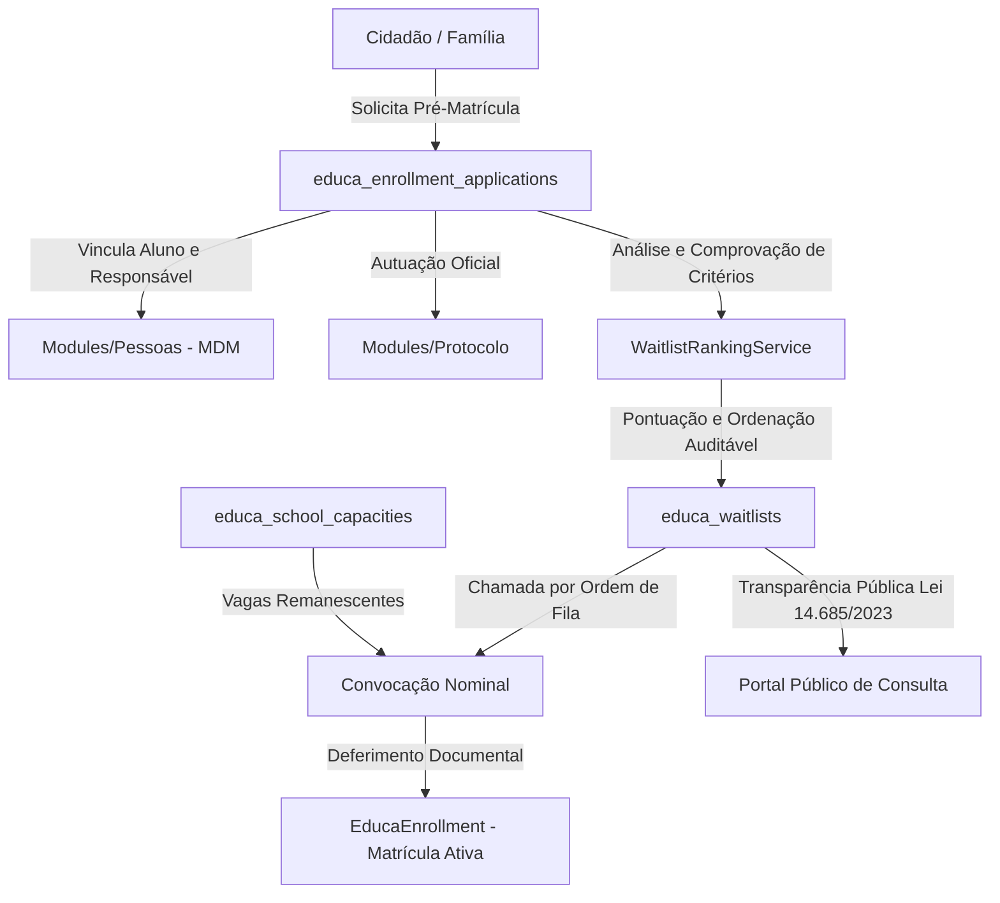

# Decisões de Arquitetura e Design: Gestão de Vagas e Fila de Espera (SYS-Educa)

## 1. Visão Geral da Arquitetura

O subsistema de **Gestão de Vagas, Fila de Espera Unificada e Pré-Matrícula** integra-se ao módulo vertical `Modules/Educa` e apoia-se nos pilares fundacionais do SYSGOV:
- **`Modules/Pessoas` (MDM)**: Identificação única de candidatos e responsáveis legais (`pessoa_id` e `responsavel_pessoa_id`), sem duplicidade cadastral de cidadãos.
- **`Modules/Protocolo`**: Autuação formal do requerimento de vaga municipal com número sequencial anual rastreável.
- **Secretaria Escolar (`EducaEnrollment`)**: Conversão direta de inscrições deferidas e convocadas em matrículas regulares ativas.
- **Multi-Tenant Estrito**: Isolamento lógico por `tenant_id` em todas as tabelas, índices e consultas.
- **Trilha de Auditoria Imutável**: Registro de todas as alterações de pontuação, reordenação e convocação no `AuditLogger`.

---

## 2. Modelagem do Banco de Dados

### 2.1 Tabela `educa_school_capacities` (Capacidade de Atendimento)
- `id` (UUID PK, `CHAR(36)`)
- `tenant_id` (`BIGINT UNSIGNED`, FK `tenants.id`)
- `school_id` (UUID FK `educa_schools.id`)
- `academic_year_id` (UUID FK `educa_academic_years.id`)
- `etapa_ensino` (`VARCHAR(50)`) — `creche_bercario`, `creche_maternal`, `pre_escola`, `fundamental_anos_iniciais`, `fundamental_anos_finais`, `eja`
- `turno` (`VARCHAR(30)`) — `matutino`, `vespertino`, `noturno`, `integral`
- `quantidade_salas` (`INT UNSIGNED`, default 1)
- `capacidade_maxima_alunos` (`INT UNSIGNED`) — teto regulamentado
- `vagas_ocupadas` (`INT UNSIGNED`, default 0)
- `vagas_reservadas` (`INT UNSIGNED`, default 0) — candidatos em fase de convocação
- `timestamps`, `softDeletes`
- Índices: `(tenant_id, school_id, academic_year_id)`, `(tenant_id, etapa_ensino, turno)`

### 2.2 Tabela `educa_enrollment_applications` (Solicitações de Pré-Matrícula)
- `id` (UUID PK, `CHAR(36)`)
- `tenant_id` (`BIGINT UNSIGNED`)
- `academic_year_id` (UUID FK `educa_academic_years.id`)
- `numero_protocolo` (`VARCHAR(50)`, índice único por tenant/ano)
- `candidato_pessoa_id` (`BIGINT UNSIGNED`, FK `pessoas.id`)
- `responsavel_pessoa_id` (`BIGINT UNSIGNED`, FK `pessoas.id`)
- `etapa_ensino` (`VARCHAR(50)`)
- `turno_preferencial` (`VARCHAR(30)`)
- `escola_preferencia_1_id` (UUID FK `educa_schools.id`)
- `escola_preferencia_2_id` (UUID nullable FK `educa_schools.id`)
- `escola_preferencia_3_id` (UUID nullable FK `educa_schools.id`)
- `status` (`VARCHAR(30)`) — `rascunho`, `inscrito`, `em_analise`, `classificado`, `convocado`, `matriculado`, `indeferido`, `desistente`
- `criterio_pcd` (`BOOLEAN`, default false) — prioridade legal
- `criterio_bolsa_familia` (`BOOLEAN`, default false) — CadÚnico
- `criterio_mae_trabalhadora` (`BOOLEAN`, default false)
- `criterio_irmao_escola` (`BOOLEAN`, default false)
- `criterio_zoneamento` (`BOOLEAN`, default false)
- `pontuacao_total` (`INT UNSIGNED`, default 0)
- `observacoes_analise` (`TEXT`, nullable)
- `analisado_por` (`BIGINT UNSIGNED` nullable FK `users.id`)
- `analisado_em` (`DATETIME`, nullable)
- `timestamps`, `softDeletes`

### 2.3 Tabela `educa_waitlists` (Posicionamento na Fila de Espera)
- `id` (UUID PK, `CHAR(36)`)
- `tenant_id` (`BIGINT UNSIGNED`)
- `application_id` (UUID FK `educa_enrollment_applications.id`)
- `school_id` (UUID FK `educa_schools.id`)
- `etapa_ensino` (`VARCHAR(50)`)
- `turno` (`VARCHAR(30)`)
- `posicao` (`INT UNSIGNED`) — ordem na fila para a escola/etapa
- `prioridade_legal` (`BOOLEAN`, default false) — PcD / medida de proteção
- `pontuacao` (`INT UNSIGNED`, default 0)
- `status` (`VARCHAR(30)`) — `aguardando`, `convocado`, `matriculado`, `recusou_vaga`, `cancelado`
- `convocado_em` (`DATETIME`, nullable)
- `limite_comparecimento` (`DATETIME`, nullable) — SLA de atendimento
- `timestamps`, `softDeletes`
- Índices: `(tenant_id, school_id, etapa_ensino, status, posicao)`

---

## 3. Serviços de Domínio e Regras de Negócio

1. **`SchoolCapacityService`**:
   - Parametrização e consulta de ocupação escolar da rede.
   - Cálculo automático de vagas remanescentes: $\text{remanescentes} = \text{capacidade\_maxima} - (\text{vagas\_ocupadas} + \text{vagas\_reservadas})$.
   - Alocação e desalocação atômica com trava pessimista (`lockForUpdate`).

2. **`EnrollmentApplicationService`**:
   - Criação de inscrições com validação de idade corte pelo MEC (31 de março).
   - Análise documental dos critérios socioeconômicos.
   - Atribuição de pontuação determinística:
     - PcD: 1000 pontos (faixa prioritária isolada)
     - CadÚnico / Bolsa Família: 100 pontos
     - Mãe trabalhadora comprovada: 50 pontos
     - Irmão matriculado na mesma escola: 30 pontos
     - Proximidade residencial (zoneamento): 20 pontos

3. **`WaitlistRankingService`**:
   - Reclassificação automática e sequenciamento da fila por escola e etapa.
   - Desempate por: (1) Menor renda per capita, (2) Maior tempo na fila (data/hora de inscrição).
   - Consulta pública anonimizada (nome em `G****** S******` e CPF/protocolo mascarados).

4. **`ApplicationEnrollmentConverterService`**:
   - Convocação com definição de prazo de SLA (ex.: 5 dias úteis).
   - Conversão de solicitação deferida em registro ativo no `EducaEnrollment`.

---

## 4. Contrato HTTP e Segurança (RBAC)

- **Middleware**: `module-access:educa-secretaria` e rotas sob `/api/educa/vagas/*`.
- **Permissões RBAC**:
  - `educa.vagas.capacidade.view`, `educa.vagas.capacidade.manage`
  - `educa.vagas.inscricoes.view`, `educa.vagas.inscricoes.manage`
  - `educa.vagas.fila.view`, `educa.vagas.fila.manage`, `educa.vagas.fila.convocar`
- **Consulta Pública**: Endpoint aberto `/api/educa/vagas/consulta-publica/{protocolo}` para atendimento à Lei nº 14.685/2023.

---

## 5. Design de Interface no Frontend (`apps/web-client`)

- **View**: `GestaoVagasView.tsx` renderizada no `EducaModule.tsx`.
- **Componentes `@sysgov/ui`**:
  - `Card`, `Badge`, `Button`, `Table`, `Tabs`, `Modal`.
  - Dados técnicos em `JetBrains Mono` (`font-mono tabular-nums`).
- **Abas**:
  1. **Capacidade da Rede**: Painel consolidado com barras de ocupação percentual por escola e etapa.
  2. **Inscrições & Triagem**: Lista de pré-matrículas com filtros de status e modal de conferência de critérios socioeconômicos.
  3. **Fila de Espera Transparente**: Visão ordenada por posição, destaque de PcD (prioridade legal) e botões de convocação nominal com contagem de SLA.
